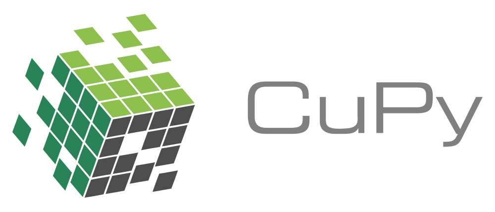
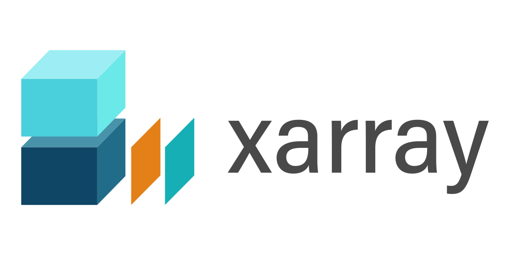

## {background-image="images/baobab.jpg" background-size="cover" background-color="#0d1117"}

::: {.overlay-caption .fragment}
I thought we'd see many of these.
:::


## {background-color="#0d1117"}

<video class="bg-fill" autoplay loop muted playsinline data-autoplay>
<source src="videos/street-scene.mp4" type="video/mp4">
</video>

::: {.overlay-caption .fragment}
…instead, we got this.
:::

## A barmy idea

::: {.incremental}
- Online implementation of the TRON pipeline (RadioStreams)
- Real-time calibration, imaging and transient detection for **MeerKAT**/**ATA**
- Breakthrough Listen invisions doing this at 1 s, 1 Hz resolution
- Need to start simpler...
:::


## From raw **TART** visibilities to vetted transients {.smaller}

24-element, single-channel and polarisation, zenith-pointing **all-sky** array -> manageable data rate.

::: {.incremental}
- The L1 sky is mostly known (dominated by **GNSS satellites**)
- Can be used as **calibrators** (no selfcal loop required)
- Makes online processing feasible
:::

. . .


::: {.highlight-box}
KREMETART = *Kalman Real-time Evidence Monitoring Extractor for TART*.
:::

## The pipeline at a glance

```{mermaid}
%%| fig-width: 9.5
%%| fig-height: 3.1
---
config:
  theme: base
  themeVariables:
    primaryColor: "#1f2937"
    primaryTextColor: "#e6edf3"
    primaryBorderColor: "#58a6ff"
    lineColor: "#8b949e"
    fontSize: "15px"
---
flowchart LR
  V[📡 Raw<br />visibilities] --> S1[① Calibrate<br />subtract + image]
  S1 --> R[🗺️ Residual maps<br />fixed sky]
  R --> S2[② Sequential<br />detection]
  S2 --> S3[③ ML ranking<br />post-alarm]
  S3 --> OUT[✅ Vetted<br />candidates]
  classDef data fill:#0d1117,stroke:#d29922,color:#e6edf3
  classDef stage fill:#1f2937,stroke:#58a6ff,color:#e6edf3
  class V,R,OUT data
  class S1,S2,S3 stage
```

. . .

A single **streaming graph** on GPU: each block is one operator with one responsibility, and a shared statistical core runs underneath the whole chain.

## One idea holds it together {.smaller}

::: {.highlight-box}
**Calibrate in the local frame. Detect on a fixed equatorial grid. Connect them by rotating the *baselines* — not the maps.**
:::

::: {.incremental}
- Calibration is natural in the local **ENU frame** — zenith-pointing, no fringe stopping, satellites move here
- Detection needs a **sidereally fixed sky**, or every steady source drifts across pixels and masquerades as a slow transient
- The imager is a **gridless DFT** → define the HEALPix grid once in equatorial coords, apply one $3\times3$ baseline rotation per frame
:::

. . .

$$\mathbf{b}\cdot(\mathbf{C}\,\hat{\mathbf{s}}) = (\mathbf{C}^{\mathsf{T}}\mathbf{b})\cdot\hat{\mathbf{s}}$$

::: {.muted}
Steady sources sit on fixed pixels; the horizon becomes a slowly sliding pixel mask — zero interpolation, identical cost.
:::

## Painting the whole sphere {.smaller}

::: {.r-stack}
<video src="videos/sphere-painting.webm" width="82%" autoplay loop muted playsinline data-autoplay></video>
:::

::: {.muted}
Each station sees one hemisphere through its soft **primary beam**; on the shared equatorial grid their views stack and the caps fill in.
Obtaining per-station beam model is an ongoing project.
:::

## One engine, used twice {.smaller}

::: {.incremental}
- Model anything slowly-varying as an **integrated Wiener process** (smoothness prior).
- Implemented online using a **Kalman filter** — exact, cheap, and handles irregular cadence.
:::

. . .

::: {.highlight-box}
The filter **whitens**: it strips out all predictable structure, leaving white *innovations*. Anything the quiescent model cannot explain **survives**.
:::

. . .

:::: {.columns}
::: {.column width="50%"}
**Calibration** (Stage 1)

Track gains & fluxes → subtract a clean model of the known sky.
:::
::: {.column width="50%"}
**Detection** (Stage 2)

Test the innovations → an unexplained excess *is* the transient.
:::
::::

## Stage 1 — streaming imager {.smaller}

```{mermaid}
%%| fig-width: 10
%%| fig-height: 1.7
---
config:
  theme: base
  themeVariables:
    primaryColor: "#1f2937"
    primaryTextColor: "#e6edf3"
    primaryBorderColor: "#58a6ff"
    lineColor: "#8b949e"
    fontSize: "15px"
---
flowchart LR
  RD[📥 Reader] --> SM[🌐 Sky model<br />catalogue fringes]
  SM --> CAL[⚙️ Calibration<br />apply known gains OTF]
  CAL --> IM[🗺️ Imaging<br />HEALPix DFT]
  IM --> IWP[〰️ Smoother<br />residual maps]
  IWP --> WR[💾 Writer<br />smooth+evidence maps]
```

::: {.incremental}
- Input a list of **.hdf** files
- Apply one complex **gain per antenna**
- Image using HEALPix DFT
- Smooth dirty image with IWP
- Implemented in a Holoscan streaming pipeline
:::

## **kremetart** software package

```bash
pip install kremetart          # lightweight CLI + cabs
pip install "kremetart[full]"  # full GPU streaming stack
```

::: {.muted}
GPU-resident streaming on **NVIDIA Holoscan** + **CuPy / CUDA**, imaging on **HEALPix** — first release shipped to PyPI.
:::

::: {.logo-wall}
{.logo-chip height="56"}
{.logo-chip height="56"}
{.logo-chip height="56"}
{.logo-chip height="56"}
{.logo-chip height="56"}
{.logo-chip height="56"}
{.logo-chip height="56"}
{.logo-chip height="56"}
{.logo-chip height="56"}
{.logo-chip height="56"}
{.logo-chip height="56"}
:::

## Next steps

::: {.incremental}
- Beam model
- Online calibration (hyper-parameters learned offline)
- Jointly image data from multiple TARTs
- Vet the transient detection machinery
- Combine with VLBI (zoom on detections)
- Contributions welcome
:::


## Thanks! {background-color="#0d1117" .closing-slide}

Looking forward to painting the full sky with your TART!

::: {.contact}
lbester@sarao.ac.za
:::
