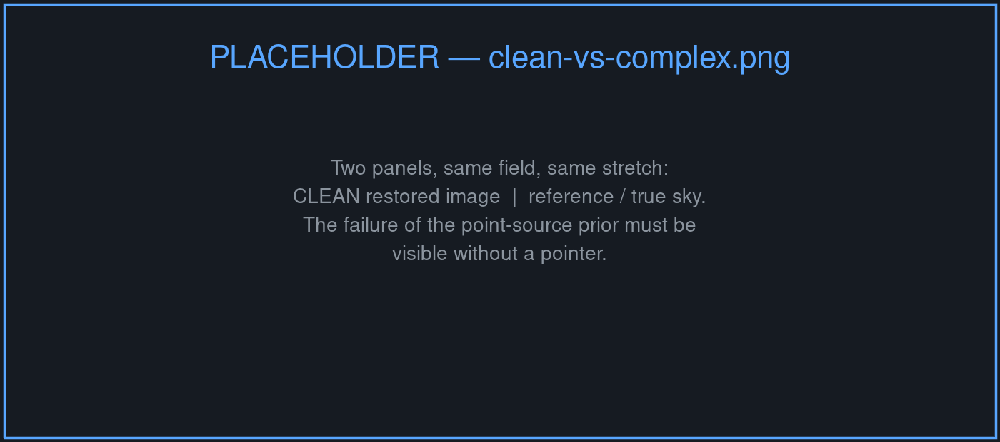
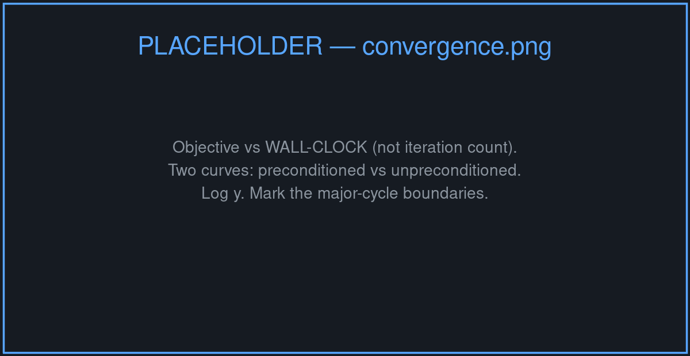
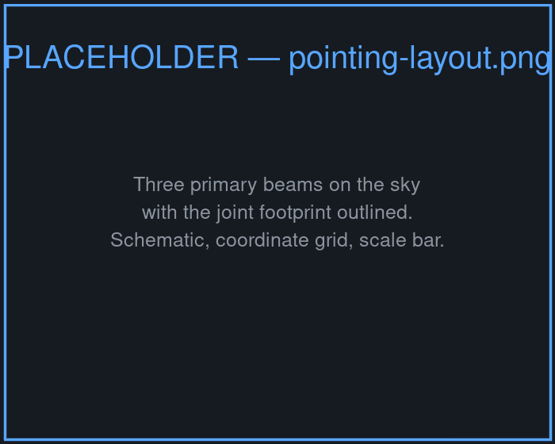
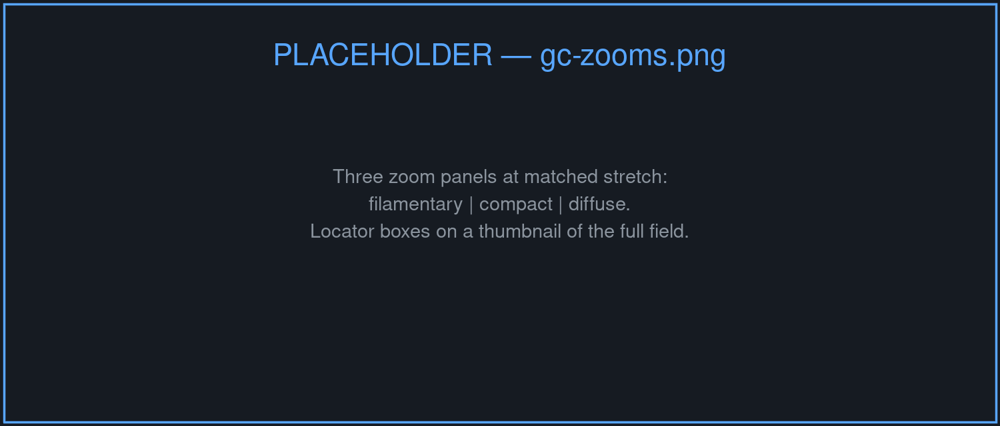
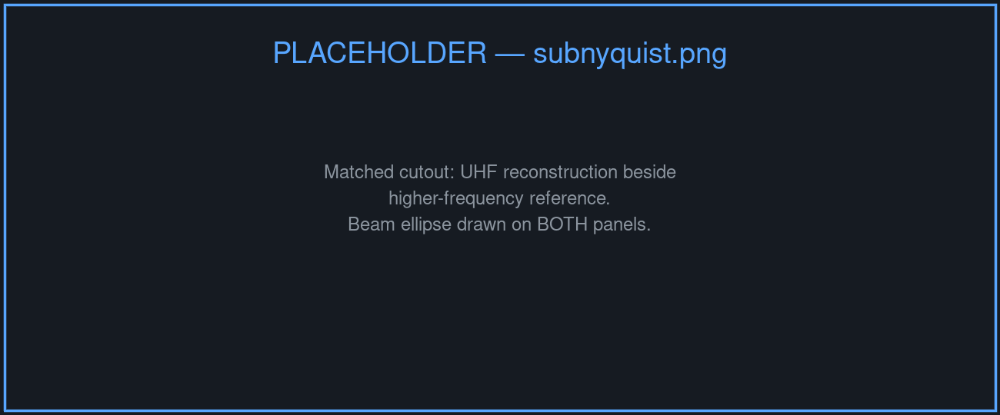

# Three MeerKAT UHF-band pointings

## {background-image="images/clean_mosaic.png" background-size="cover" background-color="#0d1117"}

::: {.overlay-caption .fragment}
Stitched image space mosaic
:::


## {background-image="images/gc-teaser.png" background-size="cover" background-color="#0d1117"}

::: {.overlay-caption .fragment}
Jointly imaged
:::

## {background-image="images/mean_sensitivity_pattern.png" background-size="cover" background-color="#0d1117"}

::: {.overlay-caption .fragment}
Mean sensitivity pattern
:::


# The adoption gap

## CLEAN is very good at what it was designed for

::: {.incremental}
- A **point-source prior**, matched to the emission that dominated the fields it was built on
- Cheap iterations — the minor cycle never touches the data
- Fifty years of accumulated operational knowledge
:::

. . .

::: {.muted}
Half this room ran it this week. Nothing that follows is an argument that it is wrong.
:::

## The sky is not a collection of points

{height="440"}

::: {.muted .small}
Filaments, diffuse structure, and extended emission at high dynamic range — where a point-source prior stops being a good description of what we are trying to recover.
:::

## The literature already has answers {.smaller}

| Approach | Since |
|---|:--:|
| Maximum entropy | 1980s |
| Sparsity / compressed sensing | ~2009 |
| Bayesian field inference (`RESOLVE`) | ~2013 |
| Plug-and-play & learned priors | ~2017 |

. . .

Each replaces the point-source prior with something better matched to complex emission.

. . .

::: {.result-box}
Almost none of them have been run on a survey-scale dataset.
:::

## Two walls {.smaller}

:::: {.columns}
::: {.column width="50%"}
### Data volume

Terabytes per observation. Out-of-core and distributed is the default case, not the hard case.
:::
::: {.column width="50%"}
### Implementation burden

Bespoke code, written once for one paper, maintained by one postdoc, inherited by nobody.
:::
::::

. . .

::: {.highlight-box}
The obstacle has not been the mathematics.
:::


# Imaging as inference

## The measurement equation

::: {.highlight-box}
$$y = R\,x + \epsilon, \qquad \epsilon \sim \mathcal{N}(0, \Sigma)$$
:::

::: {.incremental}
- $y$ — visibilities, $\mathcal{O}(10^{10})$ of them
- $R$ — the measurement operator: sampling, weighting, $w$-term, primary beam
- $x$ — the sky we want
:::

. . .

$R$ has no inverse. Everything below is a statement about what we assume instead.

## Maximum a posteriori {.smaller}

::: {.highlight-box}
$$\hat{x} = \underset{x}{\argmin}\;\;
\underbrace{-\log p(y \mid x)}_{f(x)}
\;+\;
\underbrace{-\log p(x)}_{r(x)}$$
:::

. . .

| | $f(x)$ | $r(x)$ |
|---|:---:|:---:|
| Role | data fidelity | prior |
| Fixed by | the instrument | **us** |
| Structure | smooth | possibly non-smooth |

. . .

::: {.muted}
$f(x) = \tfrac{1}{2}\|y - Rx\|^2_{\Sigma^{-1}}$ — known exactly, and not negotiable.
:::

## The prior is the only choice {.smaller}

Every method on the earlier slide is a choice of $r$ — and a non-smooth $r$ is handled through its proximal operator:

$$\prox_{\gamma r}(v) = \underset{x}{\argmin}\;\; r(x) + \frac{1}{2\gamma}\|x - v\|^2$$

. . .

::: {.result-box}
So the framework does not compete with those methods. It **hosts** them — including priors that are learned rather than written down.
:::

. . .

::: {.muted .small}
CLEAN itself is recoverable this way: a sparsity prior with a particular minor-cycle solver.
:::

## Standing on the PyData stack {.smaller}

```{mermaid}
%%| fig-width: 9
%%| fig-height: 2.1
---
config:
  theme: base
  themeVariables:
    primaryColor: "#1f2937"
    primaryTextColor: "#e6edf3"
    primaryBorderColor: "#58a6ff"
    lineColor: "#8b949e"
    fontSize: "15px"
---
flowchart LR
  A[📡 Measurement<br />set] --> B[📦 xarray<br />+ zarr]
  B --> C[⚙️ dask<br />scheduler]
  C --> D[🔭 pfb<br />operators]
  D --> E[🌌 MAP<br />solver]
  classDef data fill:#0d1117,stroke:#d29922,color:#e6edf3
  classDef stage fill:#1f2937,stroke:#58a6ff,color:#e6edf3
  class A,E data
  class B,C,D stage
```

. . .

Following the `Africanus` series: the chunking, the scheduler, the storage format and the array semantics are **inherited**, not written.

. . .

::: {.muted}
Maintenance burden moves to the ecosystem. What is left to write is the algorithm.
:::


# Making general priors affordable

## The cost of one iteration {.smaller}

Forward–backward on $f + r$:

$$x_{k+1} = \prox_{\gamma r}\bigl(x_k - \gamma \nabla f(x_k)\bigr)$$

. . .

$$\nabla f(x) = R^\dagger \Sigma^{-1}(R x - y) = \underbrace{R^\dagger \Sigma^{-1} R}_{H} x - \underbrace{R^\dagger \Sigma^{-1} y}_{d}$$

. . .

::: {.highlight-box}
Applying $H$ naively means a **degrid and a grid over every visibility**, every iteration.
:::

. . .

::: {.muted}
This — not the prior — is why the methods on slide 4 have stayed in the literature.
:::

## CLEAN's approximation {.smaller}

CLEAN's minor cycle is cheap because it never applies $H$ exactly. It assumes

::: {.highlight-box}
$$H x \;\approx\; \mathrm{PSF} \star x$$
:::

a **convolution**, evaluated by FFT at image cost rather than data cost.

. . .

The approximation is only good near the phase centre and ignores baseline-dependent effects — which is why CLEAN needs periodic **major cycles** to recompute an exact residual.

. . .

::: {.result-box}
The trick is not tied to the point-source prior. It is a statement about $H$.
:::

## Borrow the trick, keep the prior {.smaller}

:::: {.columns}
::: {.column width="50%"}
### Major cycle

*exact, data cost, few*

$$d_k = R^\dagger \Sigma^{-1}\left(y - R x_k\right)$$
:::
::: {.column width="50%"}
### Minor cycle

*approximate, FFT cost, many*

$$x \leftarrow \prox_{\gamma r}\!\bigl(x - \gamma(\tilde{H}x - d_k)\bigr)$$
:::
::::

. . .

::: {.highlight-box}
$\tilde{H}$ is the fast-convolution approximation, applied as a **preconditioner** — so an arbitrary (or learned) prior iterates at CLEAN-like cost.
:::

. . .

::: {.muted .small}
The approximation lives in the minor cycle only. The major cycle restores an exact residual, so the fixed point is the MAP solution of the *exact* problem.
:::

## What it buys {.smaller}

{height="420"}

::: {.muted .small}
Objective against **wall-clock**, preconditioned and not. Iteration count flatters the preconditioner; wall-clock is the honest axis.
:::


# MeerKAT UHF — the Galactic Centre

## The dataset {.smaller}

| | |
|---|---|
| Instrument | MeerKAT, UHF band |
| Pointings | 3, reconstructed **jointly** |
| Sky area | ~7 deg² |
| Visibilities | *TBC* |
| Channels | *TBC* |
| Data volume | *TBC* TB |
| Time to solution | *TBC* on *TBC* |

. . .

::: {.muted}
Complex extended emission at high dynamic range — the case the point-source prior handles worst.
:::

## Three pointings, one reconstruction {.smaller}

:::: {.columns}
::: {.column width="45%"}
{height="360"}
:::
::: {.column width="55%"}
::: {.incremental}
- One sky model, one prior, all data
- Deconvolution is consistent **across** pointing boundaries
- No stitching artefacts to explain away
- The primary beam enters $R$, not a post-hoc correction
:::
:::
::::

## {background-image="images/gc-full.png" background-size="cover" background-color="#0d1117"}

::: {.overlay-caption .fragment}
Seven square degrees, reconstructed jointly.
:::

## Detail

{height="470"}

::: {.muted .small}
Filamentary, compact, and diffuse regions at matched stretch.
:::

## Beyond the nominal resolution {.smaller}

{height="380"}

. . .

Structure recovered below the nominal UHF resolution is **corroborated by independent higher-frequency data** of the same region.

. . .

::: {.muted}
Suggestive, and bounded to high-SNR features — a non-linear prior can place an edge more precisely than the beam, where the data support it. Not a general resolution claim.
:::


# Where this leaves us

## Three claims {.smaller}

::: {.incremental}
- **Principled** — imaging posed as MAP estimation, so the prior is an explicit, swappable choice rather than an emergent property of a loop
- **Maintainable** — built on PyData, so the scaling machinery is someone else's problem
- **Affordable** — preconditioning gives general and learned priors CLEAN-like iteration cost
:::

. . .

::: {.result-box}
The two walls were engineering, not theory. Seven square degrees of the Galactic Centre is what it looks like when they come down.
:::

## Thanks! {background-color="#0d1117" .closing-slide}

::: {.contact}
landman.bester@gmail.com
:::

::: {.muted}
`github.com/ratt-ru/pfb-imaging`
:::
