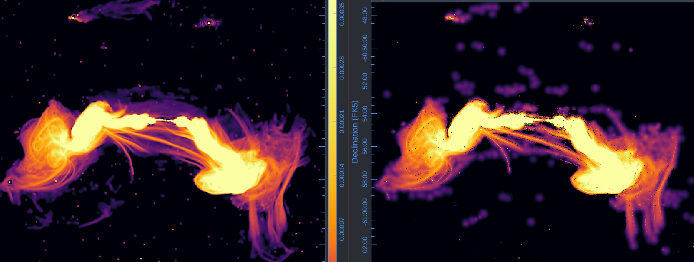

# Three MeerKAT UHF-band pointings


## {background-image="images/gc-teaser.png" background-size="cover" background-color="#0d1117" .bottom-caption-slide}

::: {.overlay-caption .fragment .small}
Jointly imaged with SARA prior
:::

<!--
## {background-image="images/mean_sensitivity_pattern.png" background-size="cover" background-color="#0d1117" .bottom-caption-slide}

::: {.overlay-caption .fragment}
Mean sensitivity pattern
:::
-->


# The adoption gap

## CLEAN is very good at what it was designed for

::: {.incremental}
- A **point-source prior**, matched to the emission that dominated the fields it was built on
- Cheap iterations — the minor cycle never touches the data
- Fifty years of accumulated operational knowledge
:::

. . .

::: {.muted}
Half this room ran it this week. Nothing that follows is an argument that it is wrong.
:::

## The sky is not a collection of points

{height="440"}

::: {.muted .small}
ESO137-006: uSARA (left) vs MSClean (right) — simplistic priors don't produce realistic images of complex diffuse structures.
:::

## The literature already has answers {.smaller}

| Approach | Since |
|---|:--:|
| Maximum entropy | 1980s |
| Sparsity / compressed sensing | ~2009 |
| Bayesian field inference (`RESOLVE`) | ~2013 |
| Plug-and-play & learned priors | ~2017 |

. . .

Each replaces the point-source prior with something better matched to complex emission (not point sources).

. . .

::: {.result-box}
None of them are routinely deployed on survey-scale data.
:::

## Two walls {.smaller}

:::: {.columns}
::: {.column width="50%"}
### Data volume

Terabytes per observation. Out-of-core and distributed is the default case, not the hard case.
:::
::: {.column width="50%"}
### Implementation burden

Bespoke code, maintained by a small group that specialises in algorithm development, inherited by nobody.
:::
::::

. . .

::: {.highlight-box}
The obstacle has not been the mathematics.
:::


# Imaging as inference

## The measurement equation {.smaller}

::: {.highlight-box}
$$y = R\,x + \epsilon, \qquad \epsilon \sim \mathcal{N}(0, \Sigma)$$
:::

::: {.incremental}
- $y$ — visibilities, $\mathcal{O}(10^{10})$ of them
- $R$ — the measurement operator: sampling, weighting, $w$-term, primary beam
- $x$ — the sky we want
:::

. . .

::: {.highlight-box}
Problem is ill-posed so Bayesian modelling is not optional!
:::

## Maximum a posteriori {.smaller}

::: {.highlight-box}
$$\hat{x} = \underset{x}{\argmin}\;\;
\underbrace{-\log p(y \mid x)}_{f(x)}
\;+\;
\underbrace{-\log p(x)}_{r(x)}$$
:::

. . .

| | $f(x)$ | $r(x)$ |
|---|:---:|:---:|
| Role | data fidelity | prior |
| Fixed by | the instrument | **us** |
| Structure | smooth | possibly non-smooth |

. . .

::: {.muted}
$f(x) = \tfrac{1}{2}\|y - Rx\|^2_{\Sigma^{-1}}$ — standard Gaussian likelihood (not necessarily known exactly)
:::

## Prior should be a user choice {.smaller}

::: {.highlight-box}
Different fields can require different choices of $r$
:::

. . .

::: {.highlight-box}
Non-smooth $r$ is handled through its proximal operator:
$$\prox_{\gamma r}(v) = \underset{x}{\argmin}\;\; r(x) + \frac{1}{2\gamma}\|x - v\|^2$$
:::

. . .

::: {.result-box}
`pfb-imaging` does not impose a prior, it **hosts** them
:::

. . .

::: {.muted .small}
CLEAN itself is recoverable: a sparsity prior with a particular minor-cycle solver.
:::

## Standing on the PyData stack {.smaller}

```{mermaid}
%%| fig-width: 10
%%| fig-height: 3.1
---
config:
  theme: base
  themeVariables:
    primaryColor: "#1f2937"
    primaryTextColor: "#e6edf3"
    primaryBorderColor: "#58a6ff"
    lineColor: "#8b949e"
    fontSize: "25px"
---
flowchart LR
  A[📡 Data] --> B[📦 xarray<br />+ zarr]
  B --> C[⚙️ Dask/Ray<br />schedulers]
  C --> D[🔭 pfb<br />operators+solvers]
  D --> E[🌌 spimple<br /> post-processing]
  classDef data fill:#0d1117,stroke:#d29922,color:#e6edf3
  classDef stage fill:#1f2937,stroke:#58a6ff,color:#e6edf3
  class A,E data
  class B,C,D stage
```

. . .

`Africanus` philosophy — scheduler, storage format and array semantics are **inherited**, not re-invented.

. . .

::: {.muted}
Maintenance burden moves to the ecosystem. What is left to write is the algorithm.
:::


# Making general priors affordable

## The cost of one iteration {.smaller}

Forward–backward on $f + r$:

$$x_{k+1} = \prox_{\gamma r}\bigl(x_k - \gamma \nabla f(x_k)\bigr)$$

. . .

$$\nabla f(x) = R^\dagger \Sigma^{-1}(R x - y) = \underbrace{R^\dagger \Sigma^{-1} R}_{H} x - \underbrace{R^\dagger \Sigma^{-1} y}_{d}$$

. . .

::: {.highlight-box}
Applying $H$ naively means a **degrid and a grid over every visibility**, every iteration.
:::

. . .

::: {.muted}
This — not the prior — is the barrier to adopting more sophisticated methods.
:::

## CLEAN's approximation {.smaller}

CLEAN's minor cycle is cheap because it never applies $H$ exactly. It assumes

::: {.highlight-box}
$$H x \;\approx\; \mathrm{PSF} \star x$$
:::

a **convolution**, evaluated by FFT at image cost rather than data cost.

. . .

::: {.result-box}
Approximation not perfect so **major cycles** are required to compute the exact residual.
The trick is not tied to the point-source prior. It is a statement about $H$.
:::

## Borrow the trick, keep the prior {.smaller}

:::: {.columns}
::: {.column width="50%"}
### Major cycle

*exact, data cost, few*

$$d_k = R^\dagger \Sigma^{-1}\left(y - R x_k\right)$$
:::
::: {.column width="50%"}
### Minor cycle

*approximate, FFT cost, many*

$$x \leftarrow \prox^\tilde{H}_{\gamma r}\!\bigl(x + \gamma \tilde{H}^{-1} d_k \bigr)$$
:::
::::

. . .

::: {.highlight-box}
$\tilde{H}$ is the fast, invertible Hessian approximation (the **preconditioner**)
:::

. . .

::: {.result-box}
Arbitrary prior iterates at CLEAN-like cost — generalised forward modelling based minor cycle
:::


# MeerKAT UHF — the Galactic Centre

## The observation {.smaller}

| | |
|---|---|
| Instrument | MeerKAT, UHF band |
| Pointings | 3, reconstructed **jointly** |
| Sky area | ~5 deg² |
| Image Size | 10000 x 10000 x 8 |
| Data volume (before averaging) | ~1 TB |
| Time to solution | 50 hours with uSARA algorithm |

. . .

::: {.muted}
Complex extended emission at high dynamic range — the case the point-source prior handles worst.
:::

## What forward modelling buys {.smaller}

{height="420"}

::: {.muted}
Enables incorporating systematics in a statistically robust way
e.g. inhomogeneous primary beams
:::

## Three pointings, one reconstruction

::: {.incremental}
- One sky model, one prior, all data
- Deconvolution is consistent **across** pointing boundaries
- No stitching artefacts to explain away
- Improved $uv$-coverage (resolution)
- The primary beam enters $R$, not a post-hoc correction
:::

## {background-image="images/GC_UHF_CLEAN.png" background-size="cover" background-color="#0d1117" .bottom-caption-slide}

::: {.overlay-caption .smaller}
Mosaicing with MSClean prior
:::


## {background-image="images/GC_UHF_SARA.png" background-size="cover" background-color="#0d1117" .bottom-caption-slide}

::: {.overlay-caption .smaller}
Jointly imaged with SARA prior
:::


## {background-image="images/GC_UHF_SARA_MODEL.png" background-size="cover" background-color="#0d1117" .bottom-caption-slide}

::: {.overlay-caption .smaller}
Intrinsic model
:::

## Caveats

::: {.incremental}
- **Computational cost** — requires more compute than than CLEAN based methods but dominated by image size operations (FFT+DWT)
- **Runtime sensitive to convergence criteria** — sub-iterative solvers need careful tuning, might be observation dependent
- **Point source fidelity** — sophisticated priors mostly target enhanced reconstruction of extended emmission (often sub-optimal for point sources)
:::


# Where this leaves us

## Three claims

::: {.incremental}
- **Principled** — imaging posed as MAP estimation, so the prior is an explicit, swappable choice rather than an emergent property of a loop
- **Maintainable** — inherited machinery is mature and maintained by the (much larger) PyData community
- **Affordable** — preconditioning gives general priors CLEAN-like iteration cost and reduces the required number of major cycles
:::

## What's next {.smaller}

::: {.incremental}
- **MeerKAT+** — Inhomogeneous beams can be dealt with by splitting data into (MK-MK, MK-MK+, MK+-MK+) baseline groups (very similar to OTF Mosaicing)
- **Acceleration** — image space operations (e.g. FFT) can be drastically accelerated on GPUs/TPUs
- **More efficient/better priors** — learnt priors (e.g. AIRI) can be far more efficient (fewer iterations) and could improve point source reconstruction
- **Multi-SPW+FIELD** — image all GC data simultaneously to obtain a high fidelity reconstruction over wide bandwidth
- **Polarisation** — polarisation imaging coming soon!
:::

## Thanks! {background-color="#0d1117" .closing-slide}

::: {.contact}
lbester@sarao.ac.za
:::

::: {.muted}
`github.com/ratt-ru/pfb-imaging`
:::

::: {.muted}
See `Africanus` [https://arxiv.org/abs/2412.12052](https://arxiv.org/abs/2412.12052) for more.
:::