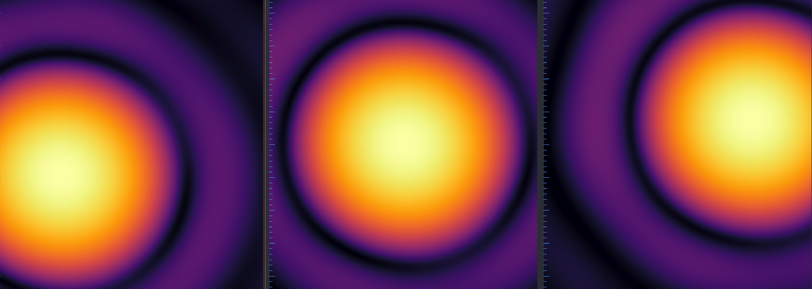
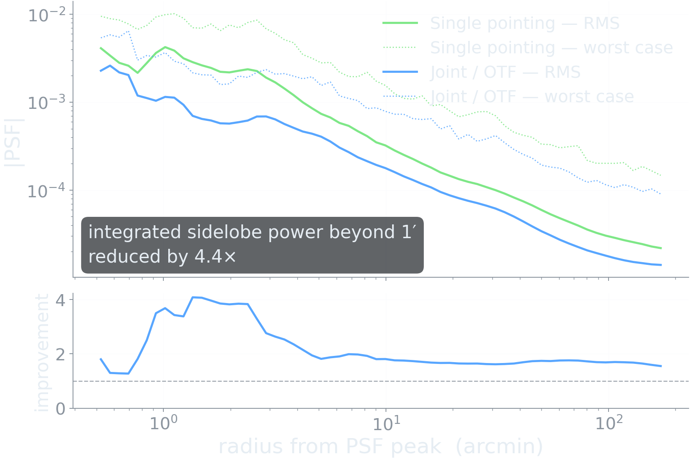
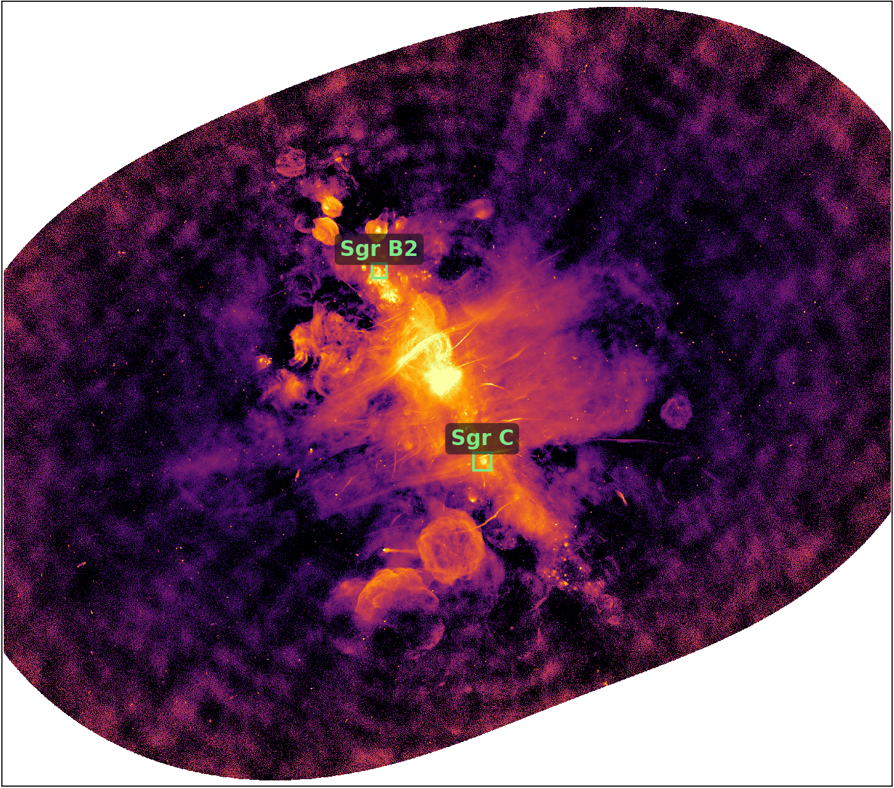
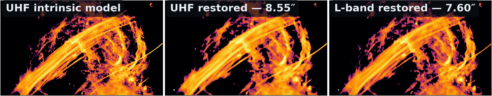
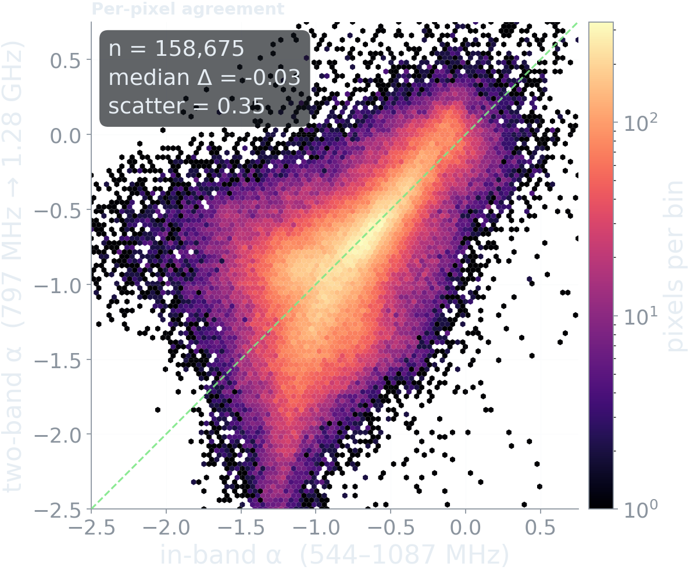
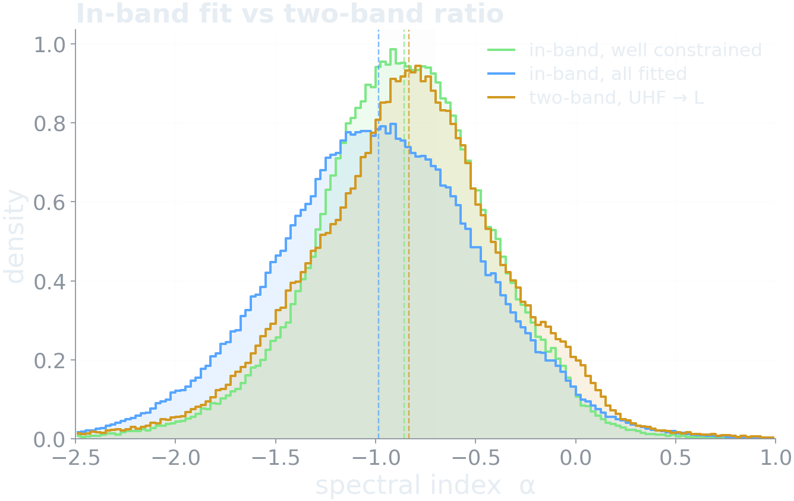
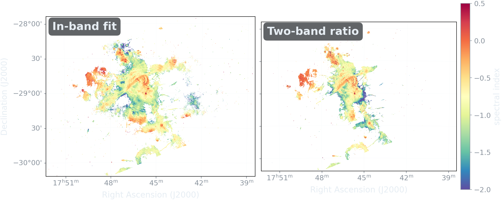
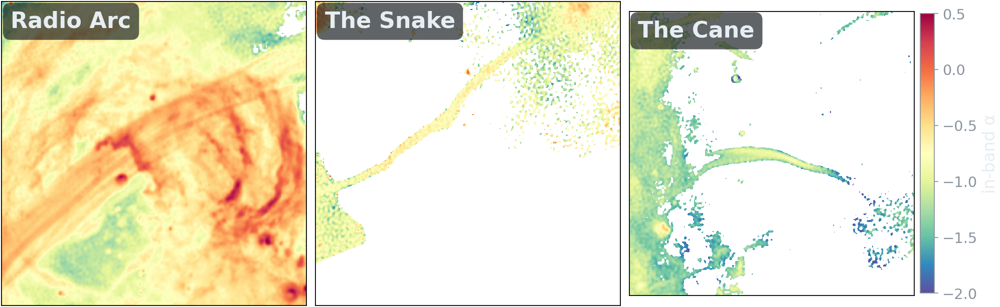
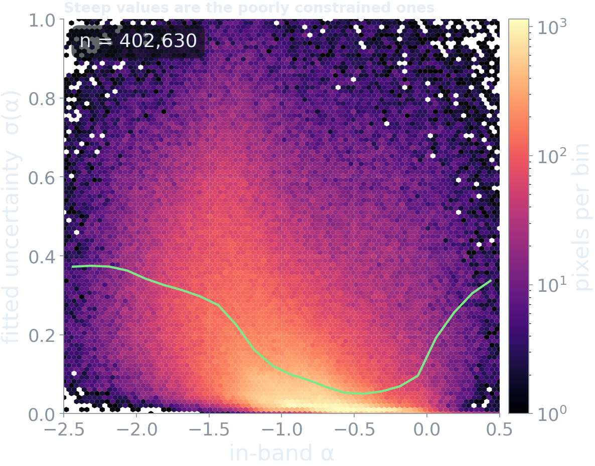

## {background-image="images/sgra-teaser.png" background-size="cover" background-color="#0d1117" .bottom-caption-slide}

::: {.overlay-caption .fragment .smaller}
544–1087 MHz. Five square degrees.
:::

::: {.overlay-caption .fragment .smaller}
The least-explored view of the Galactic Centre.
:::

# The band, and the field

## What UHF adds {.smaller}

::: {.incremental}
- **Steep-spectrum sensitivity** — emission that fades out of reach by 1.28 GHz
- **Diffuse plasma** that higher frequencies resolve out or never detect
- **Free-free absorption** becomes a usable diagnostic: thermal gas turns optically thick against the GC in this band
- **An octave of lever arm** — 544 to 1087 MHz — and roughly double that when tied to existing L-band
:::

. . .

::: {.muted}
This band is the one place several of these effects are simultaneously measurable.
:::

## Three pointings, one octave {.smaller}

::: {.incremental}
- Three **8-hour** pointings, interleaved in time, covering ~5 deg²
- 544–1087 MHz, imaged jointly with `pfb-imaging` under a **SARA** prior — sparsity in a wavelet dictionary, in place of CLEAN's point sources
- Restored to **8.55″ × 7.76″**, homogenised across the band
:::

. . .

::: {.highlight-box}
The primary beam varies strongly **across the mosaic**, and changes size by nearly **2× across the band**.
:::

. . .

::: {.muted}
Usually treated as calibration nuisances. They are the whole story for what follows.
:::

::: {.muted .small}
The imaging framework itself is **J09, this afternoon** — this talk takes it as given.
:::

## A worst-case field {.smaller}

::: {.incremental}
- Sgr A\*, Sgr A East, the Radio Arc — bright, compact, and saturating
- Filamentary structure on scales from arcseconds to degrees
- Genuinely diffuse emission underneath all of it
- Dynamic range spanning several orders of magnitude across one field
:::

. . .

::: {.result-box}
A point-source prior is a poor description of nearly everything in this image.
:::

## The open questions {.smaller}

::: {.highlight-box .fragment}
**1.** Do the non-thermal filaments share a common spectral index, or is the population heterogeneous?
:::

::: {.highlight-box .fragment}
**2.** Does $\alpha$ steepen from the **base** of the bubbles outwards, as synchrotron ageing requires?
:::

::: {.highlight-box .fragment}
**3.** Is there a distinct population of **compact steep-spectrum** sources — the radio counterpart to the GeV excess?
:::

. . .

::: {.muted}
All three are spectral-index questions. Everything that follows is about whether we can measure one here that we are willing to believe.
:::

# Mosaicking is a modelling choice

## Two ways to build a mosaic {.smaller}

:::: {.columns}
::: {.column width="50%"}
### Image space

$$\hat{x} = \sum_p w_p(l)\,\hat{x}_p$$

Deconvolve each pointing **independently**, primary-beam correct, then weighted-average.
:::
::: {.column width="50%"}
### Joint / OTF

$$y(t) = R_t\bigl[A(t)\,x\bigr] + \epsilon,\quad \epsilon \sim \mathcal{N}(0, \Sigma)$$

The **direction- and time-dependent** beam $A(t)$ is *part of* the measurement operator, not a correction applied after it. One deconvolution, all data.
:::
::::

. . .

::: {.highlight-box}
Not a workflow preference — the two are solving different problems.
:::

. . .

::: {.muted .small}
CLEAN does not minimise a stated objective, so there is no natural place to put $A(t)$ inside it. Forward modelling is available to an algorithm that solves an optimisation problem — which is **J09**.
:::

## $A(t)$ is not just time-dependent {.smaller}

To deconvolve every pointing together the data must first be **rephased to a common phase centre**. The primary beam does not come along.

{height="215"}

::: {.incremental}
- The beam is attached to where the dish **points**, not to the phase centre
- In the common frame each pointing's beam sits at a **different offset**, and the projection about the new centre **distorts** it
- So $A$ must be **reprojected** per pointing, not merely translated
:::

## The PSF is where it shows {.smaller}

{height="345"}

::: {.muted .small}
MFS PSFs, single pointing vs joint. Main lobes differ by 4%; sidelobe RMS is suppressed **4×** at arcminute scales and **~1.7×** out to 3°.
:::

. . .

::: {.result-box}
Every pointing that sees a pixel contributes — interleaved in time, so the union spans **parallactic angle** as well as position. Three times the imaging weight at the field centre.
:::

# Resolution is the hidden variable

## Homogenising resolution across the band {.smaller}

A spectral index is a **ratio across the band**, so the two images must be reporting the same thing. They are not, by default: sensitivity and uv-coverage both change with frequency, so each sub-band has its own resolution.

::: {.incremental}
- Restore every sub-band to a **common beam** — that of the lowest sub-band
- For a CLEAN model this is a convolution, because the model is $\delta$-functions
- For a sparsity prior the model has its **own** intrinsic resolution, which has to be estimated first and then corrected for
:::

. . .

::: {.result-box}
Get this wrong and the spectral index is not measuring what you think it is.
:::

## The model has a resolution too {.smaller}

CLEAN models are $\delta$-functions: intrinsic resolution **zero**, by assumption. A sparsity prior's model is not.

::: {.incremental}
- Its intrinsic resolution is **non-zero**, and set by the data and the prior together
- It is **not constant across the band** — sensitivity and uv-coverage both change
- Restore with a single beam and that variation is baked into every $\alpha$
:::

. . .

::: {.highlight-box}
So the restore step has to *estimate* the model resolution before homogenising.
:::

. . .

::: {.muted}
It cannot do so exactly: the model's intrinsic resolution is **SNR-dependent**. Homogenisation is an approximation.
:::

## {.plain-figure}

{height="620"}

## The Radio Arc {.smaller}

{height="250"}

::: {.muted .small}
UHF intrinsic model · UHF restored, 8.55″ · L-band restored, 7.60″ × 5.35″. Individual filament strands are separated in the model, blended at the UHF restoring beam — and independently confirmed by the L-band image.
:::

# Does the science hold up?

## Two independent estimates {.smaller}

:::: {.columns}
::: {.column width="55%"}
{height="340"}
:::
::: {.column width="45%"}
**In-band** — 544–1087 MHz, eight sub-bands homogenised to 11.7″

**Two-band** — 797 MHz → 1.28 GHz, restored images at 8.6″ and 7.6″

Both **intrinsic**; both carry the same mask.

::: {.fragment}
::: {.result-box}
Median offset **−0.03**, scatter 0.35, over 158 675 pixels.
:::
:::
:::
::::

::: {.fragment}
::: {.muted .small}
Nothing forces these to agree. That they do says the resolution handling — homogenisation across the band, and the beam-area correction between them — is not introducing a systematic at the level we could detect.
:::
:::

## The distribution

{height="420"}

::: {.muted .small}
Both routes peak within 0.1 of each other, near $\alpha \approx -0.9$ — ordinary non-thermal emission.
:::

## The two spectral index maps

{height="400"}

::: {.muted .small}
Left: in-band fit, 544–1087 MHz. Right: two-band ratio, 797 MHz → 1.28 GHz. Same colour scale **and the same mask**, so a colour difference is a disagreement and not a difference in which pixels survived.
:::

## Back to question 1 {.smaller}

{height="290"}

:::: {.columns}
::: {.column width="46%"}
| System | all fitted | at 10–30 mJy |
|---|:--:|:--:|
| Radio Arc | −0.58 | **−0.92** |
| The Snake | −0.87 | **−0.68** |
| The Cane | −1.22 | **−1.20** |
:::
::: {.column width="54%"}
::: {.fragment}
Raw, the spread is **0.64** and the population looks heterogeneous.
:::

::: {.fragment}
Matched in surface brightness the ordering **reverses**, and only the Cane survives as genuinely steep.
:::
:::
::::

## What you cannot see in either map {.smaller}

:::: {.columns}
::: {.column width="55%"}
{height="300"}
:::
::: {.column width="45%"}
Median in-band $\alpha$, binned by its own fitted uncertainty:

| $\sigma_\alpha$ | median $\alpha$ |
|---|---|
| < 0.02 | **−0.55** |
| 0.2 – 0.4 | −1.20 |
| 0.4 – 0.8 | **−1.30** |
:::
::::

. . .

::: {.result-box}
A 0.75 swing driven by how well each pixel was constrained.
:::

. . .

::: {.muted}
Any weakly-constrained subsample will look like a steep-spectrum population. An $\alpha$ map without its error map is not interpretable.
:::

# What is the resolution of a MAP image?

## The restoring beam asserts a resolution {.smaller}

For a quadratic regulariser the MAP estimate is a **linear filter applied to the truth**:

$$\hat{x} = \underbrace{\left(H + \lambda L\right)^{-1} H}_{K}\, x_{\rm true} + \text{noise},
\qquad H = R^\dagger \Sigma^{-1} R$$

::: {.incremental}
- Row $j$ of $K$ is the **effective PSF at pixel $j$** — what $\hat{x}_j$ actually reports
- $\Sigma^{-1}$ sits *inside* $K$, so resolution is a function of **local SNR**, and for $\ell_1$, TV or learned priors of **source brightness** too
:::

. . .

::: {.result-box}
The restoring beam *asserts* a resolution. It does not *measure* one.
:::

::: {.muted .small}
$H$ is the Hessian **J09** spends its whole talk making cheap. $K$ is built from machinery we already have.
:::

## Four other fields already report theirs {.smaller}

| Field | Name for $K$ | Since |
|---|---|---|
| Geophysics / normal modes | Averaging kernel | Backus & Gilbert 1968 |
| Seismic tomography | Model resolution matrix | Menke 1989 |
| Atmospheric sounding | Averaging kernel matrix | Rodgers 2000 |
| Emission tomography | Local impulse response | Fessler & Rogers 1996 |

. . .

::: {.muted .small}
Radio interferometry is the outlier. We hid it behind the restoring beam — not because CLEAN is linear, it is not, but because a $\delta$-function model lets us *assert* zero intrinsic resolution and never check.
:::

. . .

::: {.highlight-box}
$Kv$ for a chosen probe is **one extra solve**. Affordable today, and we are not doing it.
:::

# In summary

## Summary {.smaller}

::: {.incremental}
- The GC at UHF carries the steep-spectrum and absorption diagnostics, and has been under-observed
- Joint mosaicking is a **modelling choice** — the beam is direction- *and* time-dependent, and after rephasing it must be **reprojected**, not merely shifted
- Measured on the PSF: sidelobes down **4×** at arcminute scales
- **Resolution is the variable that propagates into $\alpha$** — control for it and a heterogeneous filament population mostly collapses
- The restoring beam is an assertion, not a measurement. Other fields have reported theirs for fifty years
:::

. . .

::: {.highlight-box}
**J09, this afternoon** — how `pfb-imaging` makes an arbitrary prior affordable, and what it would take to report $R$ instead of a beam.
:::

## Thanks! {background-color="#0d1117" .closing-slide}

::: {.contact}
lbester@sarao.ac.za
:::

::: {.muted}
Sequel this afternoon in **J09** — `pfb-imaging`, and the machinery behind these images
:::
