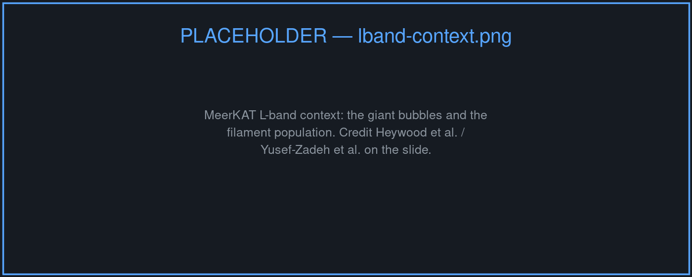
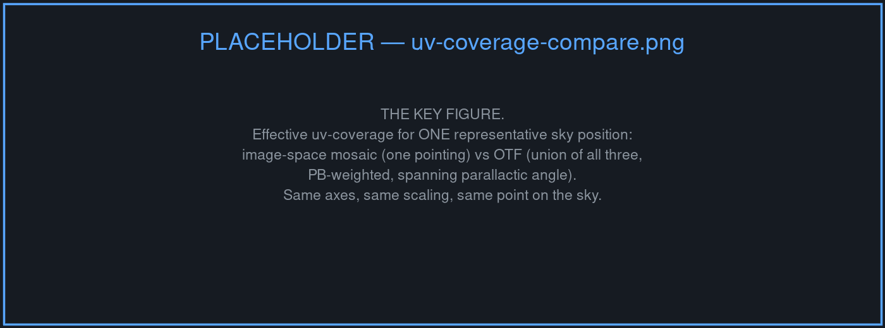
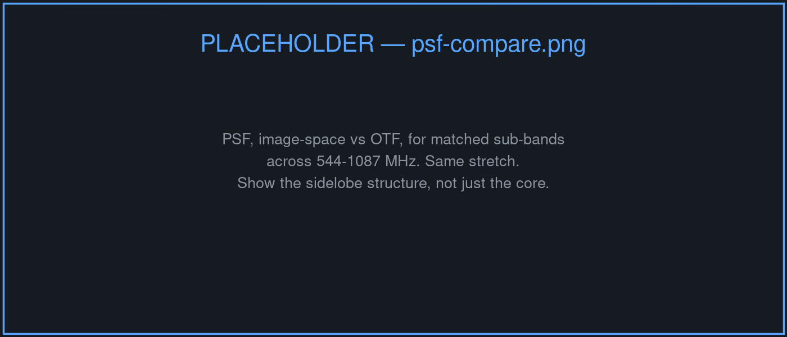
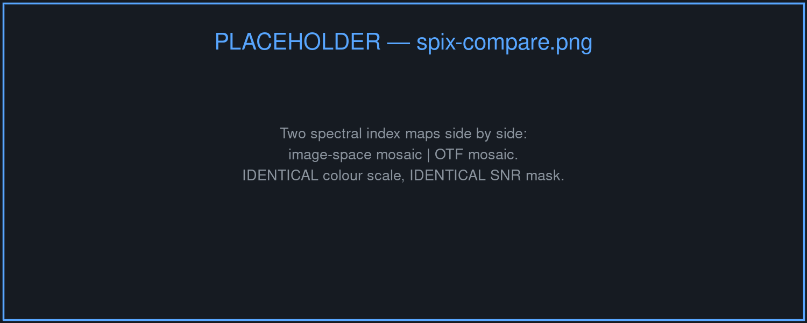
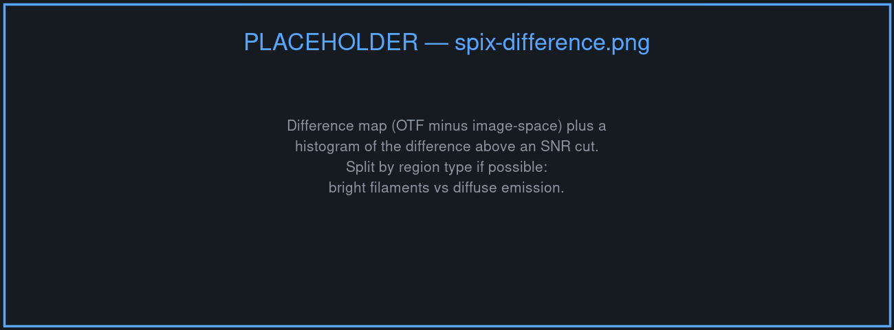
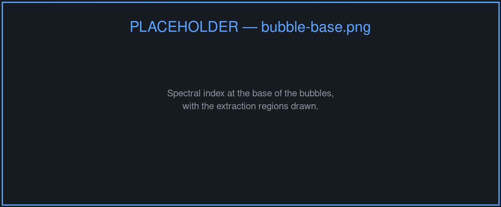
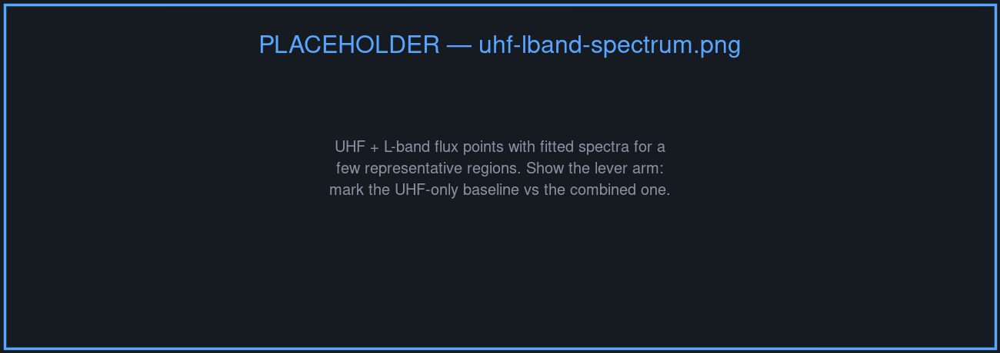

## {background-image="images/sgra-teaser.png" background-size="cover" background-color="#0d1117"}

::: {.overlay-caption .fragment}
544–1087 MHz. Seven square degrees.
:::

::: {.overlay-caption .fragment}
The least-explored view of the Galactic Centre.
:::

# Why UHF, why the Galactic Centre

## What L-band already showed us

{height="420"}

::: {.muted .small}
Giant radio bubbles and a dense population of non-thermal filaments — MeerKAT L-band. *(Heywood et al.; Yusef-Zadeh et al.)*
:::

## What UHF adds {.smaller}

::: {.incremental}
- **Steep-spectrum sensitivity** — emission that fades out of reach by 1.28 GHz
- **Diffuse plasma** that higher frequencies resolve out or never detect
- **Free-free absorption** becomes a usable diagnostic: thermal gas turns optically thick against the GC in this band
- **An octave of lever arm** — 544 to 1087 MHz — and roughly double that when tied to existing L-band
:::

. . .

::: {.muted}
This band is the one place several of these effects are simultaneously measurable.
:::

## The open questions {.smaller}

::: {.highlight-box}
**1.** Do the non-thermal filaments share a common spectral index, or is the population heterogeneous?
:::

::: {.highlight-box}
**2.** What is the spectrum at the **base** of the bubbles, where the energetics are set?
:::

. . .

::: {.muted}
Both are spectral-index questions. Everything that follows is about whether we can measure a spectral index here that we are willing to believe.
:::

# The hardest field on the sky

## A worst-case field {.smaller}

::: {.incremental}
- Sgr A\*, Sgr A East, the Radio Arc — bright, compact, and saturating
- Filamentary structure on scales from arcseconds to degrees
- Genuinely diffuse emission underneath all of it
- Dynamic range spanning several orders of magnitude across one field
:::

. . .

::: {.result-box}
A point-source prior is a poor description of nearly everything in this image.
:::

## Wide, and wideband {.smaller}

:::: {.columns}
::: {.column width="50%"}
### Wide

Three pointings, **interleaved in time**, covering ~7 deg². The primary beam response varies strongly across the mosaic.
:::
::: {.column width="50%"}
### Wideband

544–1087 MHz. The primary beam changes size by nearly **2×** across the band, and so does the uv-coverage.
:::
::::

. . .

::: {.muted}
Both facts are usually treated as calibration nuisances. They are the whole story for what follows.
:::

# The mosaic is not post-processing

## Two ways to build a mosaic {.smaller}

:::: {.columns}
::: {.column width="50%"}
### Image space

$$\hat{x} = \sum_p w_p(l)\,\hat{x}_p$$

Deconvolve each pointing **independently**, primary-beam correct, then weighted-average.
:::
::: {.column width="50%"}
### Joint / OTF

$$y(t) = R\bigl[A(t)\,x\bigr] + \epsilon$$

The time-varying beam $A(t)$ sits **inside** the measurement operator. One deconvolution, all data.
:::
::::

. . .

::: {.highlight-box}
This is a modelling choice, not a workflow preference — the two are solving different problems.
:::

## OTF improves the uv-coverage {.smaller}

{height="300"}

. . .

Image-space gets **one pointing's** uv-coverage per sky position. Joint gets the coherent **union** of every pointing that sees it, primary-beam weighted.

. . .

::: {.result-box}
Interleaved pointings make that union span parallactic angle too — more samples per pixel, not merely more sky.
:::

## What better coverage buys {.smaller}

::: {.incremental}
- Lower PSF sidelobes, and fewer of them to deconvolve away
- Fewer artefacts around the bright compact sources that dominate this field
- **Frequency-consistent** sampling — the coverage gaps are not filled differently in each sub-band
:::

. . .

::: {.highlight-box}
The third one is the point. Total intensity forgives an inconsistent PSF. A spectral index does not.
:::

# Does it actually matter?

## Spectral index is the sharpest test {.smaller}

$$\alpha = \frac{\log(S_{\nu_1}/S_{\nu_2})}{\log(\nu_1/\nu_2)}$$

. . .

A **ratio across the band** — so any frequency-dependent imaging error propagates directly into the measurement.

. . .

::: {.result-box}
An artefact that looks cosmetic in total intensity becomes a spurious spectral index gradient.
:::

. . .

::: {.muted .small}
So: rather than argue that joint mosaicking is better in principle, measure how far the choice propagates into the science.
:::

## The PSF, sub-band by sub-band

{height="440"}

::: {.muted .small}
Image-space vs OTF, matched sub-bands, same stretch. *TBC*
:::

## Two spectral index maps

{height="440"}

::: {.muted .small}
Identical colour scale, identical SNR mask. *TBC*
:::

## Where they disagree {.smaller}

{height="360"}

. . .

::: {.muted}
Difference map and histogram above an SNR cut. The interesting question is not *whether* they differ but **where** — bright filaments and diffuse emission need not behave the same way. *TBC*
:::

# The science

## {background-image="images/sgra-full.png" background-size="cover" background-color="#0d1117"}

::: {.overlay-caption .fragment}
Seven square degrees, imaged jointly.
:::

## Filament spectral indices

{height="430"}

::: {.muted .small}
The distribution across the population, not a single example. *TBC*
:::

## The base of the bubbles

{height="430"}

::: {.muted .small}
Where the energetics are set. *TBC*
:::

## The long lever arm {.smaller}

{height="340"}

. . .

::: {.muted}
UHF combined with existing L-band roughly doubles the frequency baseline — what that constrains about magnetic field strength and outburst history. *TBC*
:::

# In summary

## Summary {.smaller}

::: {.incremental}
- The GC at UHF is the band that carries the steep-spectrum and absorption diagnostics, and it has been under-observed
- Mosaicking is a **modelling choice**: done jointly, it improves the effective uv-coverage per sky position rather than merely stitching sky together
- Interleaved pointings add parallactic-angle diversity on top of that
- Whether it changes the **science** is an empirical question — and spectral index maps are the place to ask it
:::

. . .

::: {.muted .small}
Imaging performed with `pfb-imaging` — the framework itself is the subject of a separate talk in J09.
:::

## Thanks! {background-color="#0d1117" .closing-slide}

::: {.contact}
landman.bester@gmail.com
:::
