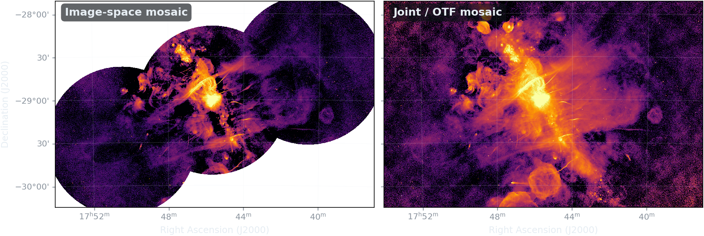

# Parked slides — sgr-a-complex-uhf

Slides cut from `index.qmd` and kept here verbatim, so a cut is reversible and so
the material is to hand during questions. Nothing in this file is rendered: the
project's `_quarto.yml` renders `*/*/index.qmd` only, so a stray `.md` beside the
deck is inert.

To reinstate one, paste its block back into `index.qmd` at the position noted,
and move any figure it needs back out of `figures/scratch/`.

---

## Cut 2026-08-16 — overlap with the J09 talk

Both talks are given on the same day (J05 in the morning, J09 after lunch) from
the same three MeerKAT UHF pointings, and both were making these two points.
J09 had already been recorded and submitted, so the duplication was resolved on
the J05 side.

### `## Every pointing that sees a pixel`

Sat between `## *A*(*t*) is not just time-dependent` and `## The PSF is where it
shows`. Five frames, ~34 s of narration.

**Why cut:** J09 slide 49 makes the same claim ("the combined uv-coverage is
better than any single pointing, which buys resolution"), and the slide that
followed this one *measures* it on the PSF rather than asserting it. The two
facts unique to this slide — the parallactic-angle span and the 3× imaging
weight — were folded into the PSF slide's `.result-box`.

```markdown
## Every pointing that sees a pixel {.smaller}

::: {.incremental}
- Image-space gets **one pointing's** uv-coverage per sky position
- Joint gets the coherent **union** of every pointing that sees it, primary-beam weighted
- Interleaved in time, so that union spans **parallactic angle** as well as position
:::

. . .

::: {.result-box}
More samples per sky position — not merely more sky.
:::

. . .

::: {.muted .small}
Three times the imaging weight at the field centre, from the same observation.
:::
```

### `## What that buys you`

Sat immediately after `## The PSF is where it shows`. Two frames, ~45 s of
narration. Needs `figures/scratch/mosaic-compare.png` moved back to `images/`.

**Why cut:** J09 spends 60 s on the same comparison across three full-bleed
slides (`GC_UHF_CLEAN` → `GC_UHF_SARA` → `GC_UHF_SARA_MODEL`), which is the set
piece of that talk.

It is also the weakest evidence in this deck, and that is worth remembering if
it is ever reinstated: the two panels differ in **deconvolution algorithm**
(MS-CLEAN vs SARA) as well as in **mosaicking scheme** (image-space vs joint),
so the figure cannot attribute the difference to either one. The same confound
is recorded against `mosaic-difference.png` in `figures/scratch/README.md`.

The closing paragraph was the better half of the slide and survives on
`## Two ways to build a mosaic`, where it now carries the pointer to J09.

```markdown
## What that buys you {.smaller}

{height="330"}

::: {.muted .small}
Same sky, same colour scale. Left: each pointing deconvolved independently with **multi-scale CLEAN**, then averaged — the pointing footprints survive. Right: one **SARA** deconvolution over all three.
:::

. . .

::: {.muted .small}
CLEAN does not minimise a stated objective, so there is no natural place to put $A(t)$ inside it. Forward modelling is available to an algorithm that solves an optimisation problem.
:::
```

### `## What we could publish instead`

Sat after `## Four other fields already report theirs`, closing the MAP section.
Four frames, ~40 s of narration.

**Why cut:** the section was condensed from three slides to two, and this is the
implementation half of the argument — how you would actually compute $K$, and
what it costs. That is J09's subject. What stays in J05 is the claim (the
restoring beam asserts a resolution) and the evidence that four other fields
report theirs; the one-line cost estimate moved into the `.highlight-box` on the
four-fields slide.

Note the notation: this block predates the rename of the resolution matrix from
$R$ to $K$, done so that $R$ means the measurement operator in both talks.
Reinstating it means rewriting $Rv$ as $Kv$ and $\mathrm{diag}(R)$ as
$\mathrm{diag}(K)$.

```markdown
## What we could publish instead {.smaller}

::: {.incremental}
- **A resolution field, not a beam** — $Rv$ for a chosen probe is one JVP through the solver's fixed point; $\mathrm{diag}(R)$ is $\mathcal{O}(10)$ Hutchinson probes
- **Fix the resolution by construction** where the science is a per-pixel fit — forfeit super-resolution, gain a defined estimand
- **Move the science model into the forward problem** — fit spectra against visibilities, so the regulariser and the physical model are the same object
:::

. . .

::: {.highlight-box}
Cost: one extra solve per probe. This is affordable today and we are not doing it.
:::
```

### `## Super-resolution zooms` (Sgr B2, Sgr C)

Cut earlier, when the two per-region zoom slides were replaced by a single Radio
Arc zoom taken from a ds9 region file. The figures were deleted rather than
parked — they regenerate from `scripts/figures/compare_regions.py` in seconds,
given a region file. The Radio Arc region is tracked at
`scripts/figures/regions/radio-arc.reg`.


# What is the resolution of a MAP image?

## The restoring beam asserts a resolution {.smaller}

For a quadratic regulariser the MAP estimate is a **linear filter applied to the truth**:

$$\hat{x} = \underbrace{\left(H + \lambda L\right)^{-1} H}_{K}\, x_{\rm true} + \text{noise},
\qquad H = R^\dagger \Sigma^{-1} R$$

::: {.incremental}
- Row $j$ of $K$ is the **effective PSF at pixel $j$** — what $\hat{x}_j$ actually reports
- $\Sigma^{-1}$ sits *inside* $K$, so resolution is a function of **local SNR**, and for $\ell_1$, TV or learned priors of **source brightness** too
:::

. . .

::: {.result-box}
The restoring beam *asserts* a resolution. It does not *measure* one.
:::

::: {.muted .small}
$H$ is the Hessian **J09** spends its whole talk making cheap. $K$ is built from machinery we already have.
:::

## Four other fields already report theirs {.smaller}

| Field | Name for $K$ | Since |
|---|---|---|
| Geophysics / normal modes | Averaging kernel | Backus & Gilbert 1968 |
| Seismic tomography | Model resolution matrix | Menke 1989 |
| Atmospheric sounding | Averaging kernel matrix | Rodgers 2000 |
| Emission tomography | Local impulse response | Fessler & Rogers 1996 |

. . .

::: {.muted .small}
Radio interferometry is the outlier. We hid it behind the restoring beam — not because CLEAN is linear, it is not, but because a $\delta$-function model lets us *assert* zero intrinsic resolution and never check.
:::

. . .

::: {.highlight-box}
$Kv$ for a chosen probe is **one extra solve**. Affordable today, and we are not doing it.
:::