# Motivation

## The Atmospheric Window

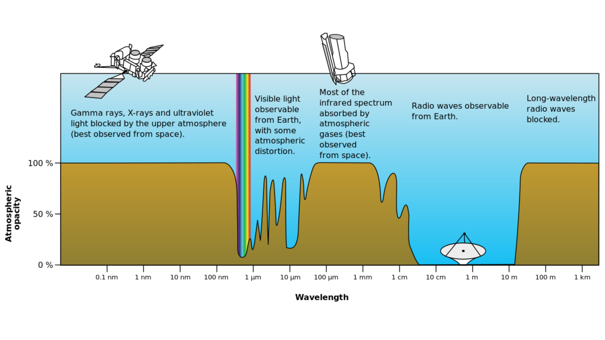{width="85%" fig-align="center"}

## Motivation for Interferometry

:::: {.columns}
::: {.column width="50%"}
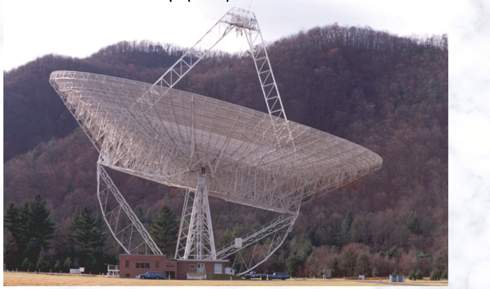{width="100%"}
:::

::: {.column width="50%"}
::: {.fragment}
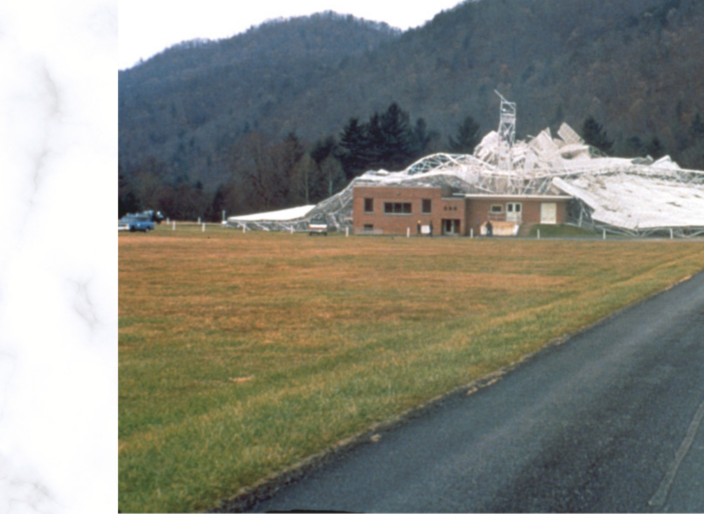{width="100%"}
:::
:::
::::

## Bigger Dishes Won't Get Us There {.smaller}

A single dish of diameter $D$ has angular resolution

$$\delta\theta \approx \frac{\lambda}{D}$$

. . .

But we want:

::: {.incremental}
- **more sensitivity** — more collecting area
- **higher resolution** — at $\lambda = 21$ cm, arcsecond resolution needs $D \sim 40$ km!
:::

. . .

::: {.highlight-box}
**Aperture synthesis**: combine many small dishes into one giant *virtual* aperture.
:::

## A Two-Element Interferometer {.smaller}

:::: {.columns}
::: {.column width="45%"}
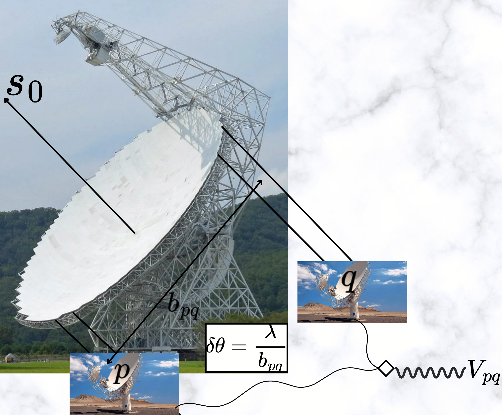{width="100%"}

::: {.fragment .highlight-box fragment-index=3}
more antennas **+** earth rotation **+** frequency coverage **=** fewer holes
:::
:::

::: {.column width="55%"}
**Assuming perfect calibration**, the correlator measures

$$V_{pq} = \int I(s) \exp\left(-2\pi\imath \frac{\nu}{c}\, b_{pq}^T (s - s_0)\right) ds$$

::: {.fragment fragment-index=1}
A baseline $b_{pq}$ resolves scales $\delta\theta \approx \lambda / b_{pq}$ — resolution is set by antenna *separation*, not dish size.
:::

::: {.fragment fragment-index=2}
::: {.callout-warning}
## Resolution does not come for free!
A single baseline measures one spatial frequency at a time.
:::
:::
:::
::::

# Aperture Synthesis

## The MeerKAT Array

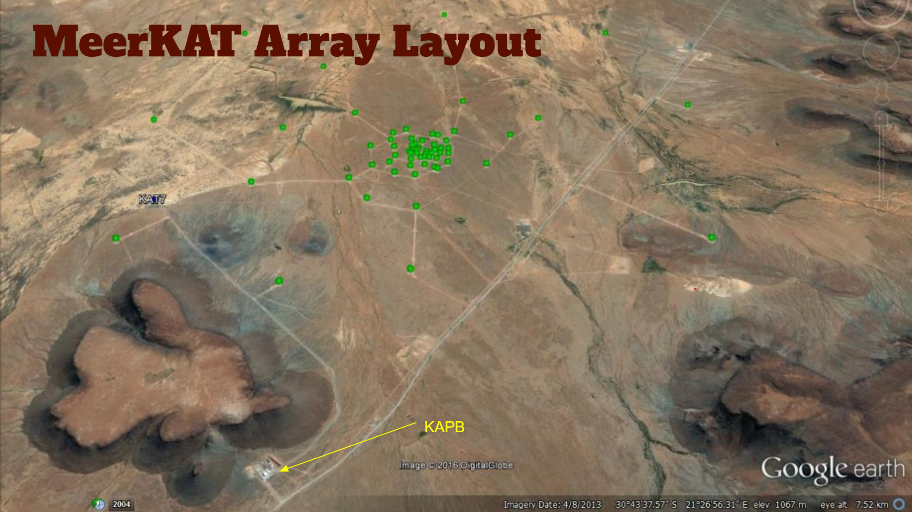{width="75%" fig-align="center"}

## Sampling the uv-Plane {.smaller}

:::: {.columns}
::: {.column width="40%"}
Sampling pattern defined by **relative position of antennas**

::: {.fragment fragment-index=1}
**Earth rotation** causes baselines to trace out elliptical tracks
:::

::: {.fragment fragment-index=2}
**Frequency coverage** fills the uv-plane radially: $u, v \propto \nu / c$
:::
:::

::: {.column width="60%"}
::: {.r-stack}
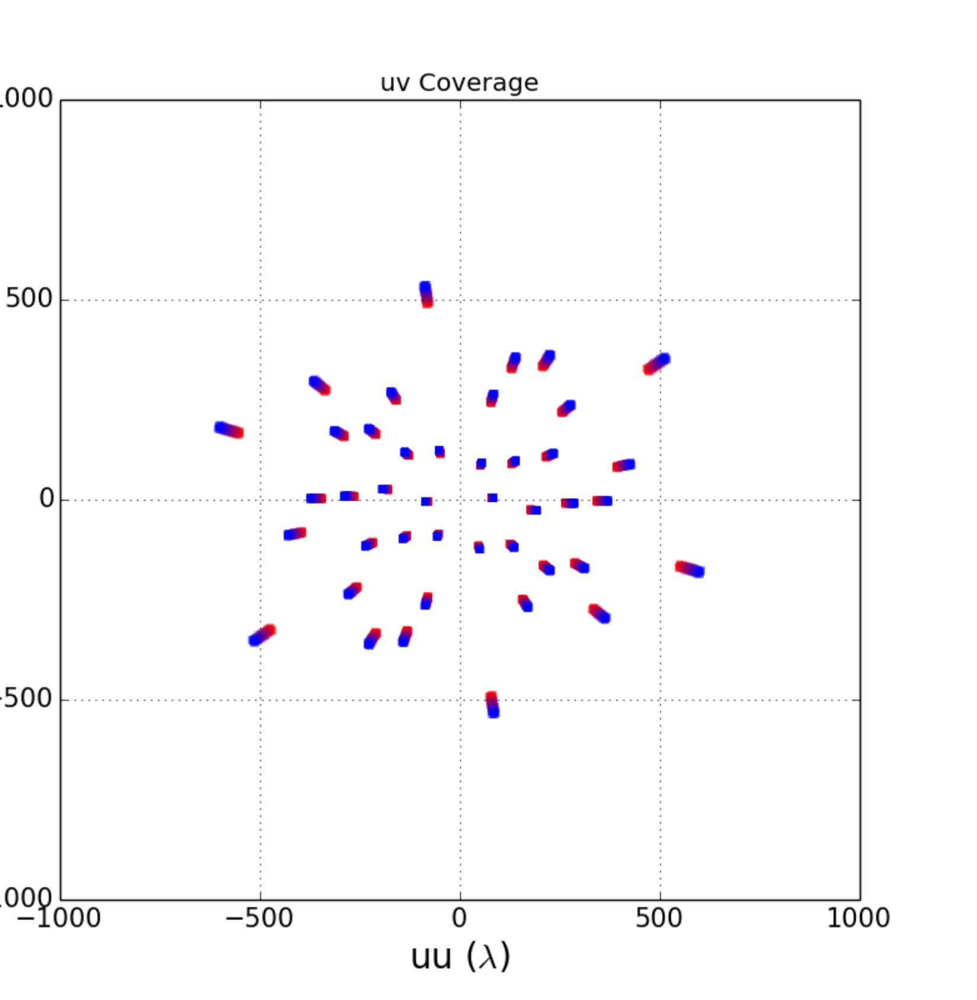{height="550"}

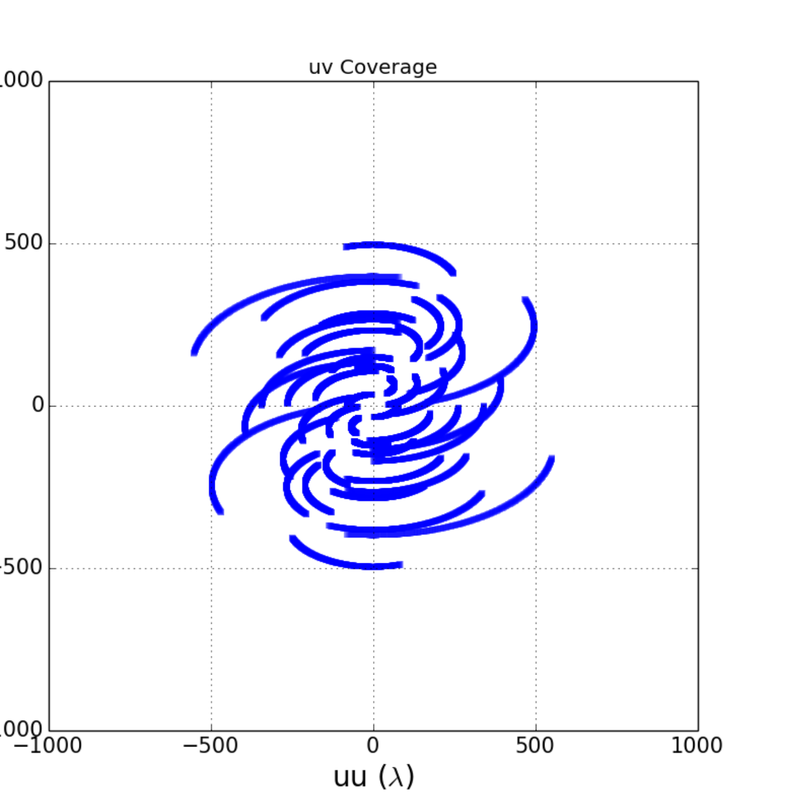{.fragment fragment-index=1 height="550"}

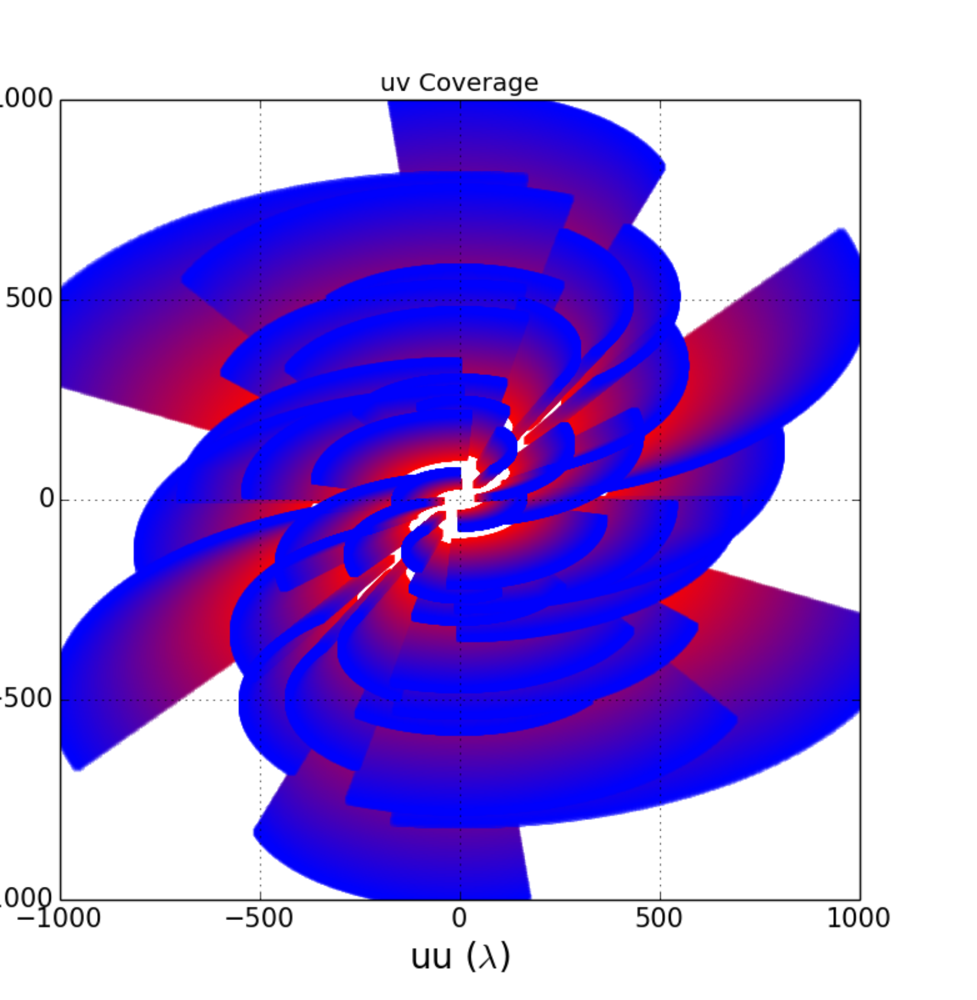{.fragment fragment-index=2 height="550"}
:::
:::
::::

## Sampling Depends on Declination {.smaller}

The same array, observing at different declinations:

::: {.r-stack}
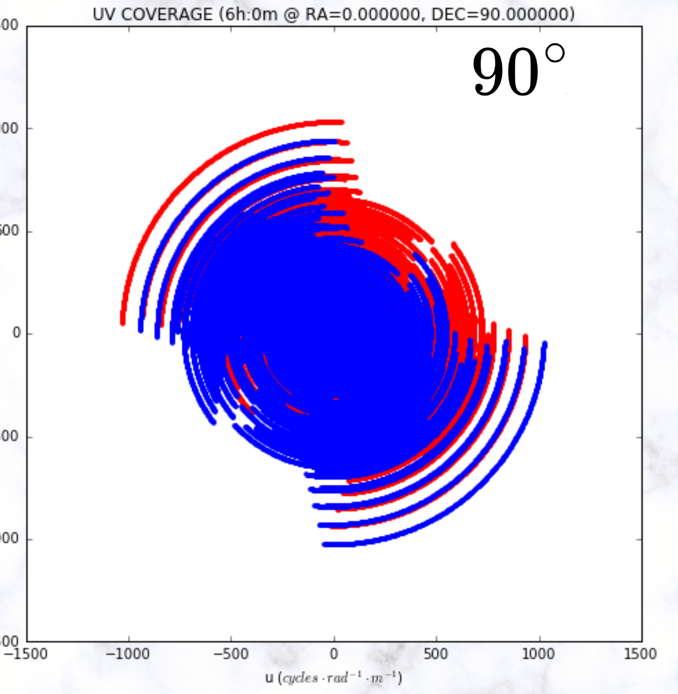{height="500"}

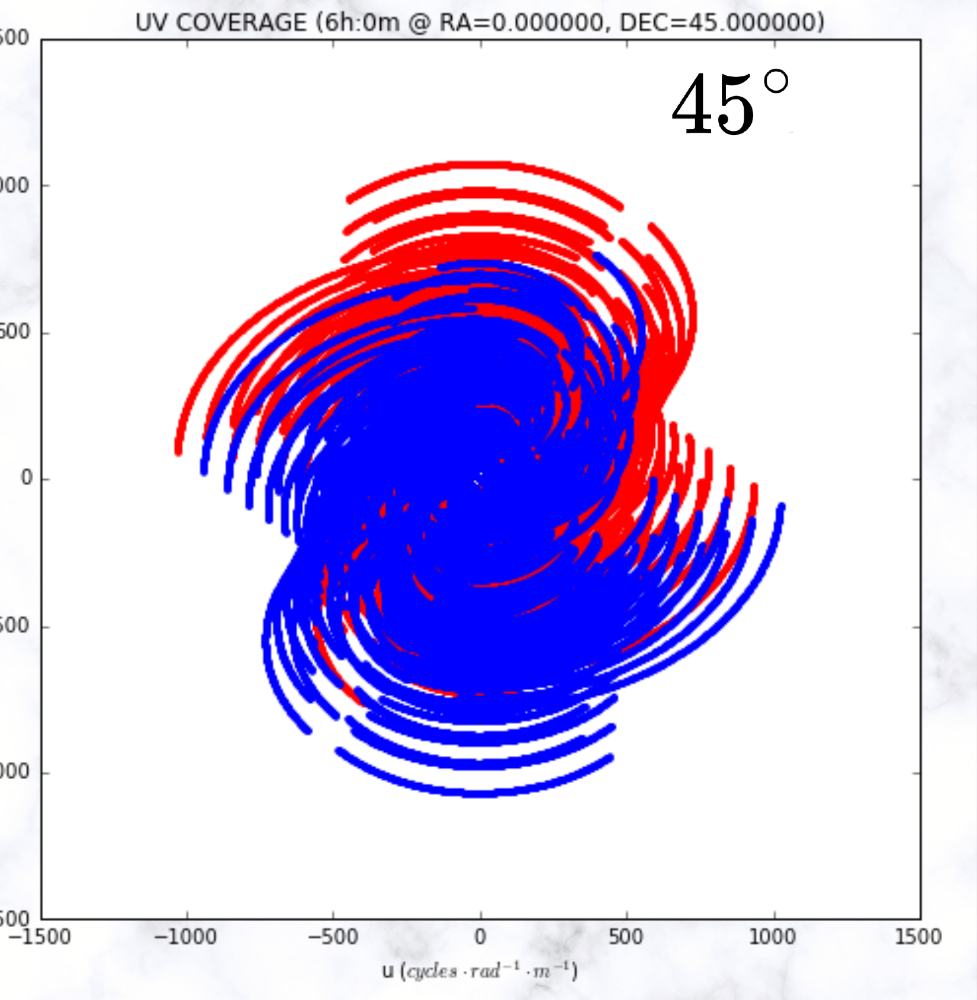{.fragment height="500"}

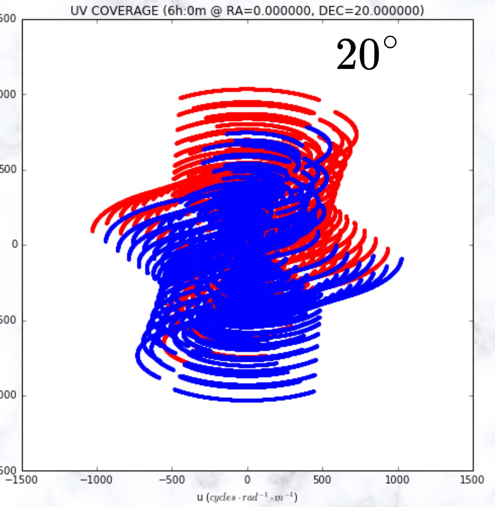{.fragment height="500"}

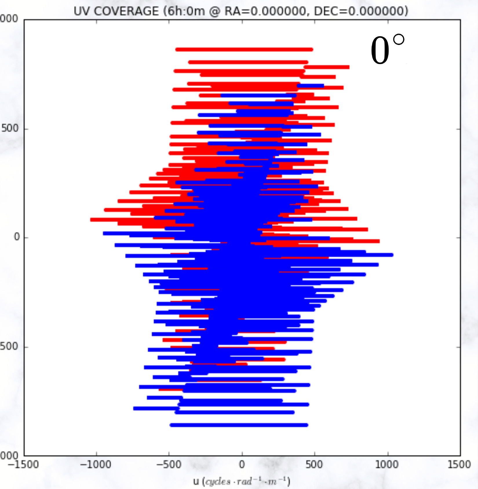{.fragment height="500"}
:::

# Fourier Theory

## Fourier Transform Definition

$$X(\nu) = \int_{-\infty}^{\infty} x(t)\, e^{-2\pi\imath\nu t}\, dt$$

. . .

The inverse transform:

$$x(t) = \int_{-\infty}^{\infty} X(\nu)\, e^{2\pi\imath\nu t}\, d\nu$$

. . .

::: {.highlight-box}
$x(t) \leftrightarrow X(\nu)$ form a **Fourier pair** — no information is lost going back and forth.
:::

## Some Fourier Transform Pairs

| $x(t)$ | $\overset{\mathcal{F}}{\longleftrightarrow}$ | $X(\nu)$ |
|:---:|:---:|:---:|
| $A_0\,\delta(t - t_0)$ | | $A_0\, e^{-2\pi\imath\nu t_0}$ |
| $\Pi(t)$ | | $\mathrm{sinc}(\nu)$ |
| $\exp(-a t^2)$ | | $\sqrt{\tfrac{\pi}{a}}\, \exp\!\left(-\tfrac{\pi^2\nu^2}{a}\right)$ |
| $\text{Ш}(t)$ — bed of nails | | $\text{Ш}(\nu)$ — bed of nails |

::: {.muted}
Narrow in one domain $\leftrightarrow$ wide in the other.
:::

## Fourier Theorems {.smaller}

| Theorem | Statement |
|:--|:--|
| **Linearity** | $\mathcal{F}[a x(t) + b y(t)] = a\mathcal{F}[x] + b\mathcal{F}[y]$ |
| **Shift** | $\mathcal{F}[x(t - t_0)](\nu) = e^{-2\pi\imath\nu t_0}\, \mathcal{F}[x](\nu)$ |
| **Similarity** | $\mathcal{F}[x(at)](\nu) = \frac{1}{|a|}\, \mathcal{F}[x]\!\left(\frac{\nu}{a}\right)$ |
| **Convolution** | $\mathcal{F}[x \star y](\nu) = \mathcal{F}[x](\nu)\, \mathcal{F}[y](\nu)$ |
| **Parseval** | $\langle x, y \rangle = x^\dagger y = \langle \mathcal{F}[x], \mathcal{F}[y] \rangle$ |

. . .

::: {.result-box}
The **convolution theorem** is the workhorse of radio interferometry — incomplete uv-sampling is a *multiplication* in Fourier space, hence a *convolution* in the image.
:::

## Example — Bed of Nails Convolved with Sinc

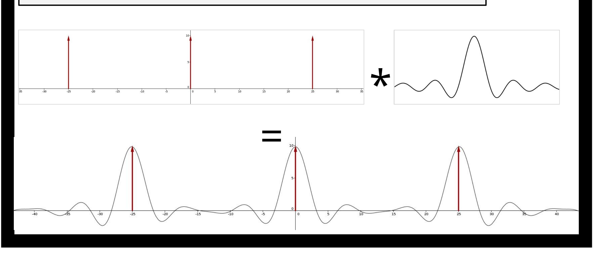{width="90%" fig-align="center"}

::: {.muted}
Convolving with a sinc $\leftrightarrow$ multiplying by a box: a perfect low-pass filter.
:::

## Discrete Fourier Transform {.smaller}

$$X_k = \sum_{n=0}^{N-1} x_n\, e^{-2\pi\imath \frac{kn}{N}},
\qquad
x_n = \frac{1}{N} \sum_{k=0}^{N-1} X_k\, e^{2\pi\imath \frac{kn}{N}}$$

with samples and frequencies on regular grids:

$$t_n = t_0 + n\Delta t, \qquad \nu_k = \frac{k}{N\Delta t}, \qquad f_s = \frac{1}{\Delta t}$$

. . .

- $\Delta t$ — the **sampling interval** (in imaging: the *cell size*)

. . .

- $f_s$ — the **sampling rate** sets the maximum frequency in the spectrum

. . .

::: {.result-box}
Implemented using the **FFT**, with computational complexity $\mathcal{O}(N \log_2 N)$ instead of $\mathcal{O}(N^2)$.
:::

## Sampling Theorem and Aliasing {.smaller}

:::: {.columns}
::: {.column width="55%"}
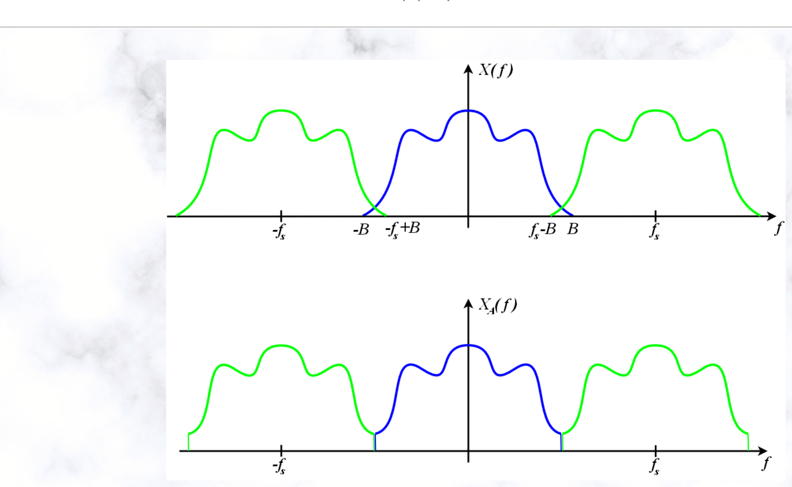{width="100%"}
:::

::: {.column width="45%"}
A band-limited signal with maximum frequency $B$ is fully determined by samples spaced $\Delta t \leq \tfrac{1}{2B}$ apart.

::: {.fragment}
::: {.highlight-box}
**Nyquist criterion**

$$f_s \geq 2B
\qquad \text{or} \qquad
\Delta t \leq \frac{1}{2B}$$
:::
:::
:::
::::

# Van Cittert-Zernike

## Van Cittert-Zernike {.smaller}

$${\color{#58a6ff}{V_{pq}}} = \int {\color{#3fb950}{I(l,m)}} \exp\left(-2\pi\imath \frac{\nu}{c} \left({\color{#d29922}{u_{pq}}}\, {\color{#f778ba}{l}} + {\color{#d29922}{v_{pq}}}\, {\color{#f778ba}{m}} + {\color{#d29922}{w_{pq}}}\, ({\color{#f778ba}{n}} - 1)\right)\right) \frac{dl\, dm}{n}$$

::: {.incremental}
- ${\color{#58a6ff}{V_{pq}}}$ — **visibilities**: the data the interferometer measures
- ${\color{#3fb950}{I(l,m)}}$ — the **total intensity image** we are after
- ${\color{#d29922}{(u, v, w)}}$ — **Fourier-space coordinates**: the baseline in wavelengths
- ${\color{#f778ba}{(l, m, n)}}$ — **image-space coordinates**: direction cosines on the sky
- the $(n - 1)$ term — directions measured relative to the **phase center**
:::

## The Celestial Sphere {.smaller}

:::: {.columns}
::: {.column width="40%"}
The sky is not flat — direction cosines live on the unit sphere:

$$n = \sqrt{1 - l^2 - m^2}$$

::: {.fragment}
Near the phase center $n \approx 1$, and the $w_{pq}(n-1)$ term vanishes.
:::
:::

::: {.column width="60%"}
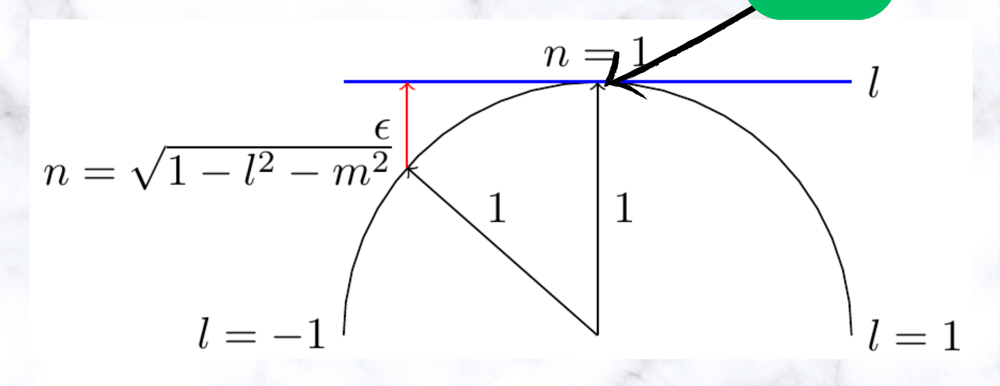{width="100%"}
:::
::::

## Imaging — How To Obtain the Image From Measured Visibilities? {.smaller}

$$V_{pq} = \int I(l,m) \exp\left(-2\pi\imath \frac{\nu}{c} \left(u_{pq} l + v_{pq} m + \underbrace{w_{pq}(n-1)}_{\approx\, 0}\right)\right) \frac{dl\, dm}{n}$$

. . .

::: {.highlight-box}
A **2D Fourier transform** — in the absence of wide-field effects.
:::

. . .

uv-coverage is determined by the instrument $\;\Rightarrow\;$ set the **cell size** based on the Nyquist criterion

. . .

What about the **field of view** (i.e. `npix`)?

## Primary Beam Pattern {.smaller}

:::: {.columns}
::: {.column width="55%"}
::: {.incremental}
- Shape of the dish determines the antenna **sensitivity pattern** (yet more Fourier transforms)
- **Time and frequency dependent!**
- Primary source of **direction-dependent effects** for MeerKAT
- This is what determines the **required field of view**
:::
:::

::: {.column width="45%"}
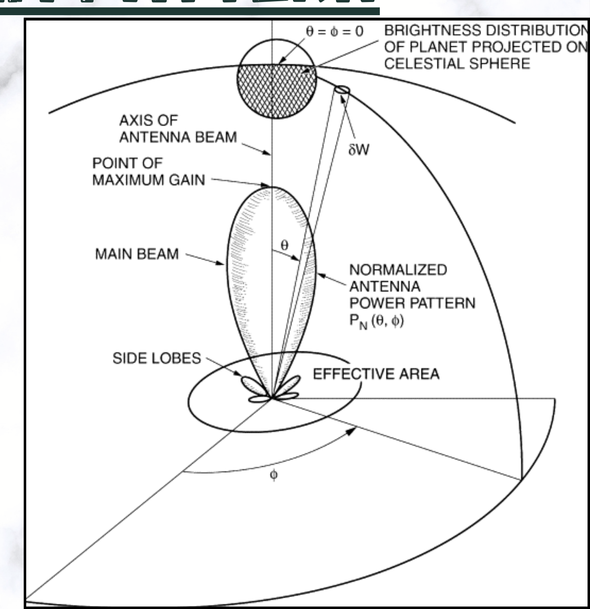{height="280" fig-align="center"}

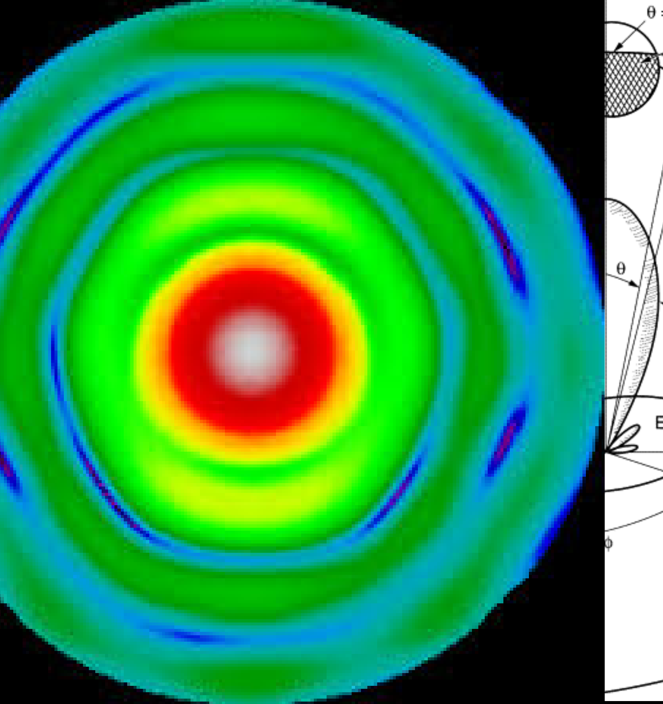{height="280" fig-align="center"}
:::
::::

# Imaging Weights

## Gridding the Data {.smaller}

:::: {.columns}
::: {.column width="50%"}
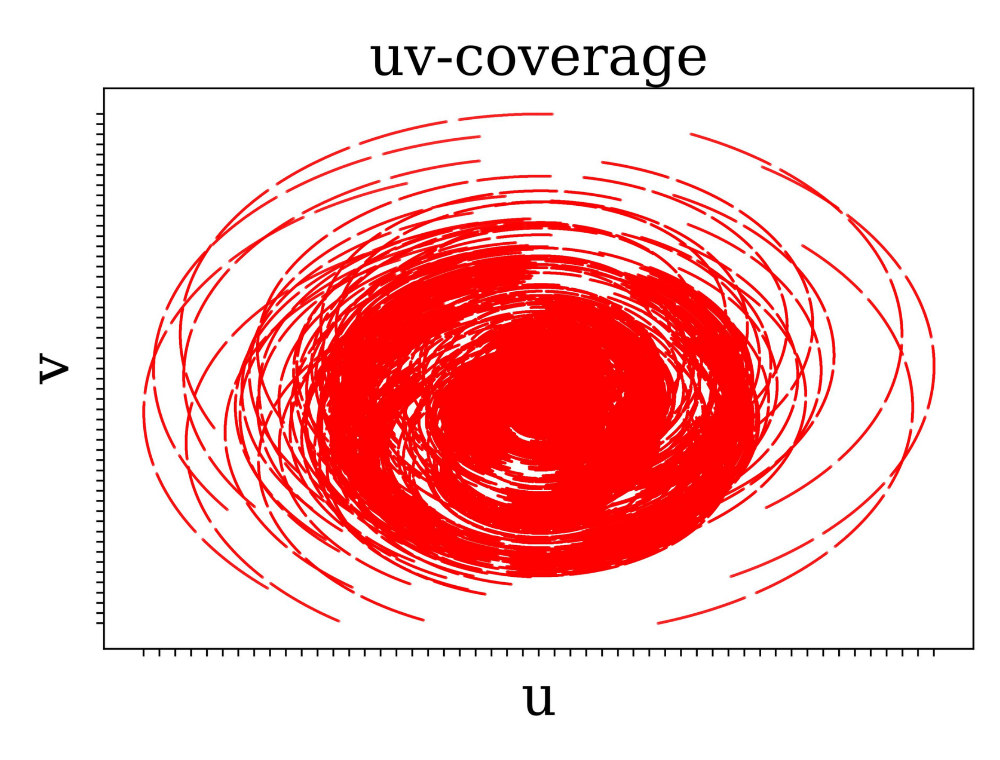{width="100%"}
:::

::: {.column width="50%"}
The FFT needs data on a **regular grid** — visibilities are sampled along tracks.

::: {.fragment}
Many samples can land in one cell: how we **weight** them changes the effective PSF.
:::
:::
::::

## Natural vs Uniform Weighting {.smaller}

:::: {.columns}
::: {.column width="50%"}
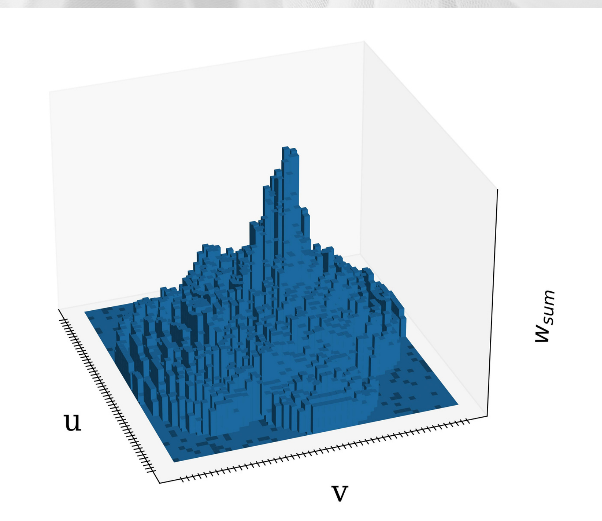{width="100%"}
:::

::: {.column width="50%"}
::: {.fragment}
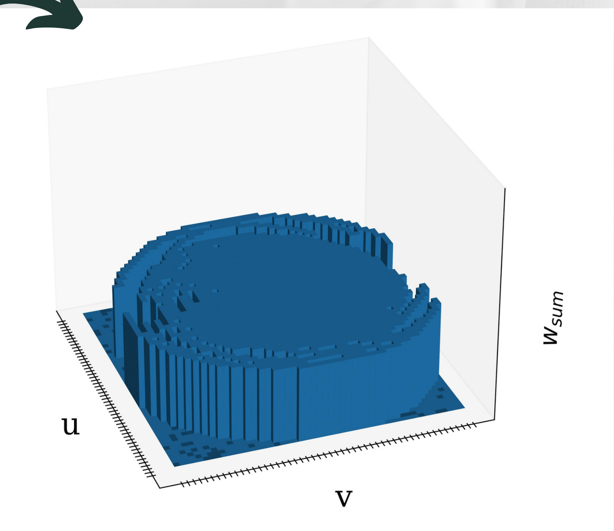{width="100%"}
:::
:::
::::

. . .

Natural maximizes sensitivity; uniform maximizes resolution.

## Natural vs Uniform

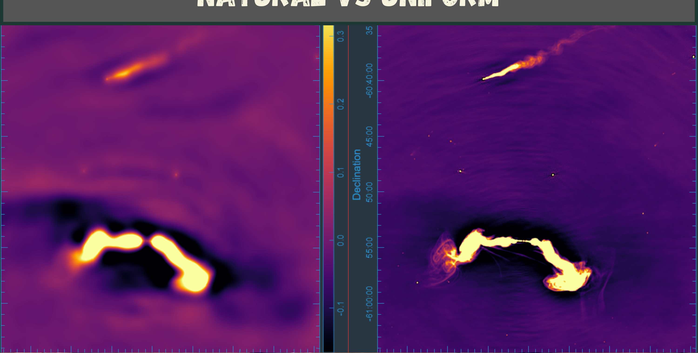{width="90%" fig-align="center"}

# Calibration {background-image="images/galaxies.png" background-opacity="0.3"}

## The Radio Interferometer Measurement Equation {.smaller}

:::: {.columns}
::: {.column width="45%"}
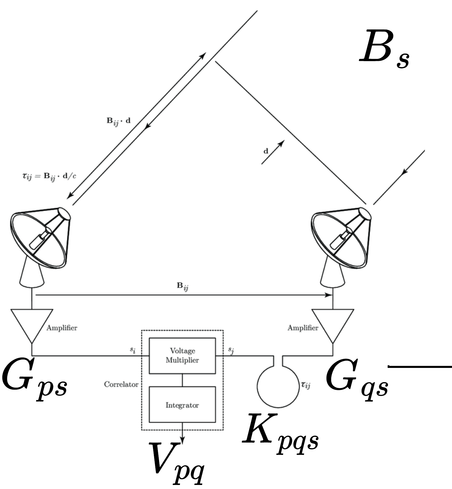{height="500"}
:::

::: {.column width="55%"}
$$V_{pq} = \int_s G_{ps}\, B_s\, G_{qs}\, K_{pqs}\; ds$$

::: {.incremental}
- $B_s$ — the **brightness** of the sky in direction $s$
- $K_{pqs}$ — the **geometric phase delay** between antennas $p$ and $q$
- $G_{ps},\, G_{qs}$ — direction-dependent **antenna gains**
:::

::: {.fragment}
The instrument corrupts the signal **before** it is measured!
:::
:::
::::

## Calibration vs Imaging {.smaller}

$$V_{pq,t\nu} = \int_s \left(\,
{\color{#d29922}{\mathbf{J}_{p,t\nu}}}\;
{\color{#58a6ff}{\mathbf{X}_{s}}}\;
{\color{#d29922}{\mathbf{J}^\dagger_{q,t\nu}}}
\,\right) k_{pq,t\nu}\; ds$$

. . .

- ${\color{#d29922}{\mathbf{J}_{p,t\nu}}}$ — **calibration**: solve for the Jones matrices, given a model of the sky

. . .

- ${\color{#58a6ff}{\mathbf{X}_{s}}}$ — **imaging**: solve for the sky, given the gains

. . .

::: {.highlight-box}
A chicken-and-egg **inverse problem** — solved by alternating between the two (self-calibration).
:::

## How Does It Work in Practice? {.smaller}

Interleave scans of known calibrator sources with the science target:

```{mermaid}
%%| fig-width: 9
%%| fig-height: 1.8
---
config:
  theme: base
  themeVariables:
    primaryColor: "#1f2937"
    primaryTextColor: "#e6edf3"
    primaryBorderColor: "#58a6ff"
    lineColor: "#8b949e"
    fontSize: "16px"
---
flowchart LR
    P1[🎯 Primary calibrator<br />&nbsp;flux + bandpass&nbsp;] --> S1[🧭 Secondary calibrator<br />&nbsp;time-varying gains&nbsp;]
    S1 --> T1[📡 Target<br />&nbsp;science field&nbsp;]
    T1 -. repeat .-> S1
    T1 --> P2[🎯 Primary calibrator<br />&nbsp;closing scan&nbsp;]
```

::: {.incremental}
- **Primary** — bright, stable, known flux: sets the flux scale and bandpass
- **Secondary** — close to the target: tracks time-variable gains
- **Target** — the science field, observed in between
:::

# Imaging in a Nutshell

## Imaging in a Nutshell {.smaller}

**Discretized measurement model for imaging**

$$y = Rx + \epsilon, \quad \epsilon \sim \mathcal{N}(0, \Sigma)$$

. . .

**Distribution of the noise gives**

$$\chi^2(x) \propto (y - Rx)^\dagger \Sigma^{-1}(y - Rx)
\;\Rightarrow\;
\nabla_x \chi^2 = R^\dagger \Sigma^{-1}(y - Rx)$$

. . .

**Setting the gradient to zero**

$$\nabla_x \chi^2 = 0
\;\Rightarrow\;
R^\dagger \Sigma^{-1} y = R^\dagger \Sigma^{-1} R\, x
\;\Rightarrow\;
\boxed{I^D \approx I^{\mathrm{PSF}} \star x}$$

. . .

::: {.callout-note}
## Where to next?
The dirty image is the true sky convolved with the PSF — recovering $x$ is the **deconvolution** problem.
:::

## Thanks! {background-color="#0d1117" .closing-slide}

::: {.contact}
lbester@sarao.ac.za
:::
