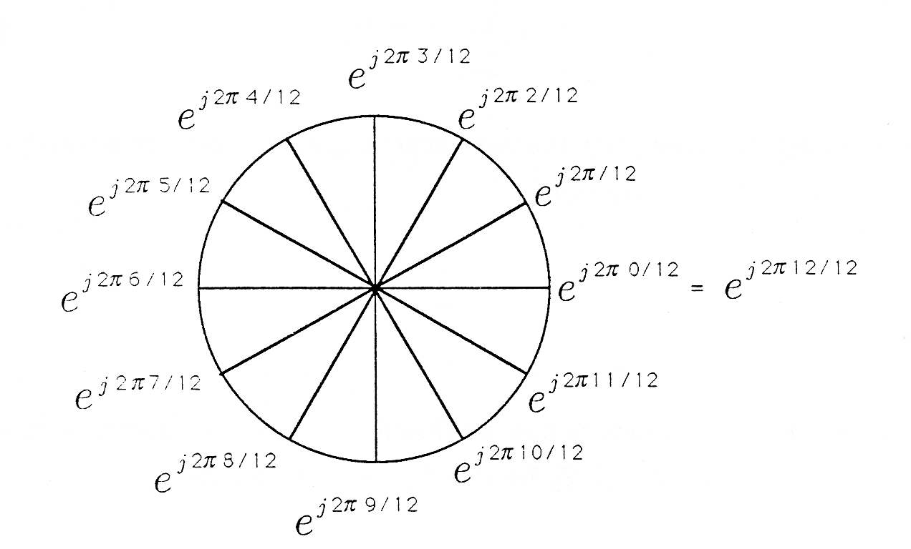
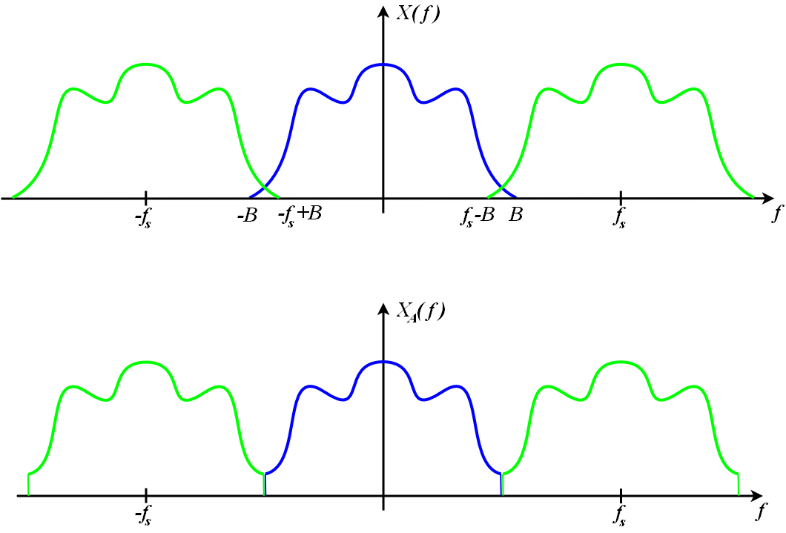

# Toeplitz Matrices

## Toeplitz Matrix

$$
T = \begin{bmatrix}
{\color{red}a} & {\color{blue}b} & {\color{green}c} & {\color{orange}d} & {\color{purple}e} \\
{\color{cyan}f} & {\color{red}a} & {\color{blue}b} & {\color{green}c} & {\color{orange}d} \\
{\color{magenta}g} & {\color{cyan}f} & {\color{red}a} & {\color{blue}b} & {\color{green}c} \\
{\color{brown}h} & {\color{magenta}g} & {\color{cyan}f} & {\color{red}a} & {\color{blue}b} \\
{\color{olive}i} & {\color{brown}h} & {\color{magenta}g} & {\color{cyan}f} & {\color{red}a}
\end{bmatrix}
$$

## Toeplitz Matrix — Key Properties

- Completely determined by $2n-1$ values (the first row and first column)

. . .

- For any $i$ and $j$, the element at position $(i,j)$ depends only on the difference $i-j$

. . .

- Formally, a matrix $T$ is Toeplitz if:

$$T_{i,j} = T_{i-1,j-1}, \quad \forall\, i, j > 1$$

# Circulant Matrices

## Circulant Matrix

$$
C = \begin{bmatrix}
{\color{red}a} & {\color{purple}e} & {\color{orange}d} & {\color{green}c} & {\color{blue}b} \\
{\color{blue}b} & {\color{red}a} & {\color{purple}e} & {\color{orange}d} & {\color{green}c} \\
{\color{green}c} & {\color{blue}b} & {\color{red}a} & {\color{purple}e} & {\color{orange}d} \\
{\color{orange}d} & {\color{green}c} & {\color{blue}b} & {\color{red}a} & {\color{purple}e} \\
{\color{purple}e} & {\color{orange}d} & {\color{green}c} & {\color{blue}b} & {\color{red}a}
\end{bmatrix}
$$

## Circulant Matrix — Key Properties

::: {.incremental}
- Completely determined by $n$ values (the first row)
- A special case of a Toeplitz matrix where the diagonals "wrap around"
- All circulant matrices are **diagonalizable by the DFT**
- The eigenvectors of any circulant matrix are the columns of the DFT matrix
:::

## Toeplitz → Circulant Embedding

A $5 \times 5$ Toeplitz can be embedded in a $9 \times 9$ circulant:

$$
C = \begin{bmatrix}
a & b & c & d & e & i^* & h^* & g^* & f^* \\
f & a & b & c & d & e & i^* & h^* & g^* \\
g & f & a & b & c & d & e & i^* & h^* \\
h & g & f & a & b & c & d & e & i^* \\
i & h & g & f & a & b & c & d & e \\
e^* & i & h & g & f & a & b & c & d \\
d^* & e^* & i & h & g & f & a & b & c \\
c^* & d^* & e^* & i & h & g & f & a & b \\
b^* & c^* & d^* & e^* & i & h & g & f & a
\end{bmatrix}
$$

::: {.notes}
The embedding allows us to use the FFT for fast Toeplitz
matrix-vector products — critical for large-scale imaging.
:::

## {background-color="#0d1117"}

::: {.callout-note}
## Exercise
Show that the eigenvalues of a circulant matrix are given by the
Fourier transform of its first row or column.
:::

## Circulants and Cyclic Permutations

$$
C = \sum_{k=0}^{N-1} c_k P^k \qquad \bm{c} = [c_0, \cdots, c_{N-1}]
$$

. . .

::: {.highlight-box}
**Polynomial in $P$** — the circulant is a polynomial in the cyclic permutation matrix!
:::

. . .

$$P_{mn} = \delta_{m,(n+1) \bmod N}$$

## Cyclic Permutation Matrix Example

$$
P_4 = \begin{bmatrix}
0 & 0 & 0 & 1 \\
1 & 0 & 0 & 0 \\
0 & 1 & 0 & 0 \\
0 & 0 & 1 & 0
\end{bmatrix}
$$

## Roots of Unity

{width=60% fig-align="center"}

# Fourier Transform

## Fourier Transform Definition

::: {.highlight-box}
$$X(\nu) = \int_{-\infty}^{\infty} x(t) \, e^{-2\pi \imath \nu t} \, dt$$
:::

. . .

The inverse transform:

::: {.highlight-box}
$$x(t) = \int_{-\infty}^{\infty} X(\nu) \, e^{2\pi \imath \nu t} \, d\nu$$
:::

::: {.notes}
$x(t)$ and $X(\nu)$ are a Fourier pair — they contain the same
information, just represented in different domains.
:::

## Some Fourier Transform Pairs

| $x(t)$ | $X(\nu)$ |
|:------:|:---------:|
| $A_0 \delta(t - t_0)$ | $A_0 e^{-2\pi \imath \nu t_0}$ |
| $\sqcap(t)$ | $\text{sinc}(\nu)$ |
| $\exp(-at^2)$ | $\sqrt{\frac{\pi}{a}} \exp(-\pi^2 \nu^2 / a)$ |
| $\vdots$ | $\vdots$ |

## Fourier Theorems

| Theorem | Formula |
|:-------:|:-------:|
| Linearity | $\Fourier[ax(t) + by(t)](s) = a\Fourier[x(t)](s) + b\Fourier[y(t)](s)$ |
| Shift | $\Fourier[x(t-t_0)] = e^{-2\pi \imath s t_0} \Fourier[x(t)]$ |
| Similarity | $\Fourier[x(at)](s) = \frac{1}{|a|}\Fourier[x(t)]\!\left(\frac{s}{a}\right)$ |
| Convolution | $\Fourier[x(t)\, y(t)](s) = \Fourier[x(t)](s) * \Fourier[y(t)](s)$ |
| Parseval | $\langle x, y \rangle = x^\dagger y = \langle \Fourier[x], \Fourier[y] \rangle$ |

::: {.notes}
Highlight the convolution theorem — this is the key to understanding
why circulant matrices are diagonalized by the DFT.
:::

## Example — Bed of Nails Convolved with Sinc

{width=90% fig-align="center"}



## Discrete Fourier Transform

:::: {.columns}
::: {.column width="55%"}
::: {.highlight-box}
$$X_k = \sum_{n=0}^{N-1} x_n \, e^{-2\pi \imath \frac{kn}{N}}$$

$$x_n = \sum_{k=0}^{N-1} X_k \, e^{2\pi \imath \frac{kn}{N}}$$
:::
:::

::: {.column width="45%"}
$$t_n = t_0 + n\Delta t$$

$$\nu_k = \frac{k f_s}{N} \qquad f_s = \frac{1}{\Delta t}$$

::: {.muted}
$\Delta t$ = sampling interval (cell size)

$f_s$ = sampling rate = max frequency
:::
:::
::::

. . .

Implemented using FFT: $\mathcal{O}(N \log_2 N)$



## Sampling Theorem and Aliasing

::: {.callout-important}
## Nyquist–Shannon Sampling Theorem
If a function $x(t)$ contains no frequencies higher than $B$ Hz,
then it can be completely determined from samples spaced less than
$\frac{1}{2B}$ seconds apart.
:::

. . .

:::: {.columns}
::: {.column width="50%"}
**Nyquist Criterion:**

$$f_s \geq 2B$$
:::
::: {.column width="50%"}
**Equivalently:**

$$\Delta t \leq \frac{1}{2B}$$
:::
::::

{width=70% fig-align="center"}

# Connecting the Pieces

## Covariance and Toeplitz Matrices

Evaluating the covariance function at all pairs of locations:

$$K_{ij} = \text{cov}(x_i, x_j) = K(t_i, t_j)$$

. . .

If the GP is stationary and isotropic:

$$K = K(r), \quad r = |t - t'|$$

. . .

::: {.result-box}
In this case the covariance matrix will be a **Toeplitz matrix**!
:::

## Covariance and Power Spectrum

Stationary and isotropic GPs can equivalently be specified via the **power spectrum**:

$$P(s) = \int K(r) \exp(-2\pi \imath s \cdot r) \, dr$$

. . .

The covariance matrix is **diagonal in Fourier space**:

$$S(s, s') \propto \delta(s - s') P(s)$$

. . .

::: {.result-box}
Crucial for **large-scale inference** with Gaussian random fields!
:::

# Linear Inverse Problems

## Linear + Gaussian Noise

The measurement model:

$$y = Rx + \epsilon, \quad \epsilon \sim \Normal{0}{\Sigma}$$

. . .

Gives rise to a likelihood:

$$p(y|x) = \frac{1}{\sqrt{(2\pi)^n|\Sigma|}}
\exp\!\left(-\frac{1}{2}(y - Rx)^\dagger \Sigma^{-1}(y - Rx)\right)$$

. . .

Can solve analytically when the prior is Gaussian: $\quad p(x) = \Normal{m}{K}$

. . .

::: {.fragment .highlight-green}
Can even use the evidence to adapt the prior to the problem!
:::

## {background-color="#0d1117"}

::: {.closing-slide}
## Thanks!

::: {.contact}
lbester@sarao.ac.za
:::
:::
