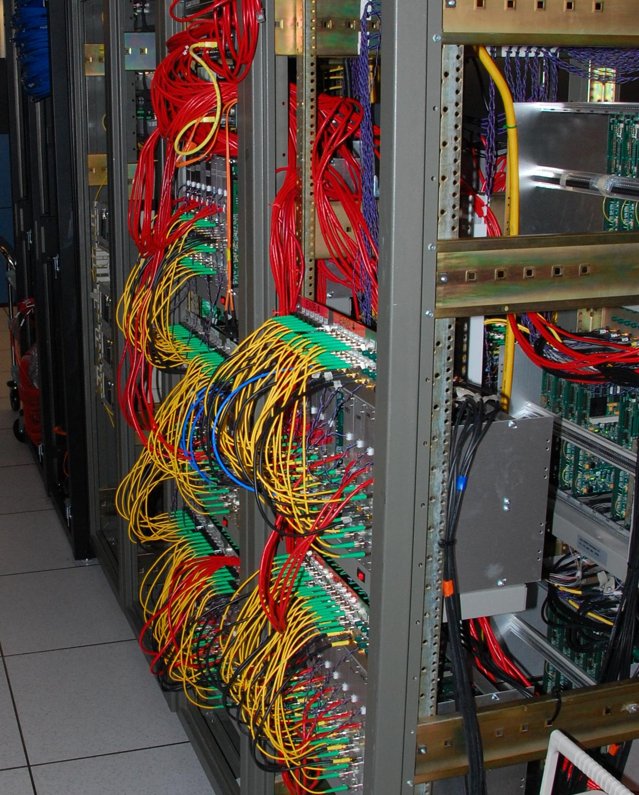

# Why we need an equation

## Where We Left Off {.smaller}

:::: {.columns}
::: {.column width="50%"}
{width="100%"}
:::

::: {.column width="50%"}
::: {.incremental}
- Two antennas listen to the same sky
- The correlator **multiplies** their signals and **averages**
- That one number, for one pair of antennas, is a **visibility** $V_{pq}$
- Many pairs, as the Earth turns, fill **visibility space**
:::
:::
::::

::: {.notes}
Recap of the morning lecture in one slide. The question for this hour: what
exactly is in that number, and what has happened to the signal on its way?
:::

## Just Some Numbers Pop Out {.smaller}

::: {.incremental}
- We say an interferometer measures **visibilities** of the sky
- Switch it on, and do visibilities pop out?
- …not quite: **just some numbers** pop out
- The instrument is like a thermometer **with no markings**
:::

. . .

{width="90%" fig-align="center"}

. . .

::: {.highlight-box}
Putting the markings on is **calibration** — and for that we need an **equation for the measurement**.
:::

::: {.notes}
Oleg's ungraduated thermometer. The mercury moves, but until we know what
each position means, the reading is just a number.
:::

## A Calibration Test {background-image="images/trinity-calibration-test.jpg" background-size="contain" background-color="#000000"}

::: {.notes}
Personnel stack 4,000 boxes of TNT, 50 pounds a box, for a 100-ton
"calibration test" on 7 May 1945. Calibration done properly: blow up
something you understand before you measure something you don't.
Ours is gentler: we point at sources we know.
:::

## The Measurement Equation {.smaller}

::: {.incremental}
- The **Radio Interferometer Measurement Equation** — the **RIME**
  - Hamaker, Bregman & Sault (1996); Hamaker (2000)
- One equation that says:
  - **what** we measure
  - **how** to calibrate
  - **how** to correct
- Today: what each part of it means — with pictures, not proofs
:::

# The RIME on one interferometer

## One Equation, One Picture

Every term in the equation is a part of the instrument — or the sky.

::: {.notes}
Next: the two-element interferometer from this morning, one term at a time.
Each click flies one term from the equation onto the part of the picture it
describes.
:::



## Reading the Equation {.smaller}

$$
{\color{#3fb950}{V_{pq}}} = \sum_s
{\color{#58a6ff}{G_p}}\;
{\color{#d29922}{B_s}}\;
{\color{#58a6ff}{G_q^*}}\;
K_{pq,s}
$$

::: {.incremental}
- [$V_{pq}$]{.key-measured} — what the correlator gives us, for antennas $p$ and $q$
- [$B_s$]{.key-sky} — the brightness of source $s$: **what we want**
- [$G_p$, $G_q^*$]{.key-gain} — what each antenna and its electronics do to the signal
- $K_{pq,s}$ — the delay between the antennas: **known geometry**
- $\sum_s$ — add up every source in the sky
:::

::: {.notes}
The star on G_q means "the mirror image" (complex conjugate): the correlator
multiplies p's signal by the mirror image of q's. Don't dwell on it.
:::

# What's hiding in G?

## G Is a Whole Journey

The signal does not just pass through "an antenna". On the way from the source it crosses space, the ionosphere, the dish and the receiver — and **each one changes it**.

::: {.notes}
Next animation: follow one wave from the source to the receiver and watch
its polarisation change at every stage. Each stage gets a letter; the letters
chain up into the Jones matrix J.
:::



## The Jones Zoo {.smaller}

| | Where | What it does to the wiggle |
|:---:|---|---|
| **K** | space | delays it — geometry, known |
| **Z** | ionosphere | delays it more — changes with the weather |
| **F** | ionosphere + magnetic field | twists it — *Faraday rotation* |
| **P** | dish mount | the sky turns as the dish tracks — known |
| **E** | dish | favours some directions — *primary beam* |
| **D** | feed | leaks one direction into the other |
| **G** | electronics | amplifies and delays each channel — *gain* |

::: {.notes}
J = G D E P F Z K is just an example chain — which letters you need depends on
the telescope and on how accurate you need to be. Read it right to left: K
happens first. Order matters because these are matrices.
:::

## Known and Unknown {.smaller}

::: {.incremental}
- Some terms we can **compute in advance**
  - **K** — from where the antennas are
  - **P** — from how the dish is mounted and where it points
- Some we can **model**
  - **E** — measure the beam once, use it many times
- The rest we have to **solve for** — that is **calibration**
  - **G**, **D**, **Z**, **F** — they change with time, frequency and weather
:::

. . .

::: {.highlight-box}
The RIME tells us exactly **which** numbers are unknown — and how they enter what we measure.
:::

# Two antennas, one equation

## Two Antennas, Two Journeys {.smaller}

:::: {.columns}
::: {.column width="38%"}
{height="480"}
:::

::: {.column width="62%"}
::: {.incremental}
- Each antenna has its **own** journey: $\mathbf{J}_p$ and $\mathbf{J}_q$
- Each antenna records **two** voltages — one per polarisation
- The correlator multiplies every pairing: $x x$, $x y$, $y x$, $y y$
- Four numbers per pair of antennas: a little **2×2 box**, the **visibility matrix**
:::
:::
::::

::: {.notes}
Photo: a correlator — all the cables bring antenna voltages to one place where
every pair is multiplied and averaged.
:::

## The RIME {.smaller}

$$
{\color{#3fb950}{\mathbf{V}_{pq}}} =
{\color{#58a6ff}{\mathbf{J}_p}}\;
{\color{#d29922}{\mathbf{B}}}\;
{\color{#58a6ff}{\mathbf{J}_q^H}}
$$

::: {.incremental}
- [$\mathbf{V}_{pq}$]{.key-measured} — the **measured** correlations (the 2×2 box)
- [$\mathbf{B}$]{.key-sky} — the **source**: its brightness and polarisation
- [$\mathbf{J}_p$]{.key-gain} — everything that happens on the way to antenna $p$
- [$\mathbf{J}_q^H$]{.key-gain} — the same for antenna $q$, in mirror image
:::

. . .

::: {.highlight-box}
Same shape as before — $G_p\,B\,G_q^*$ — with each number grown into a 2×2 box.
:::

::: {.notes}
The H plays the same role as the star on G_q: the mirror image of q's
journey. Bold letters are 2x2 matrices: one row and column per polarisation.
:::

## The Onion {.smaller}

Each effect wraps around the sky in the order the signal met it:

::: {.r-stack}
::: {.fragment .fade-in-then-out}
$$\mathbf{V}_{pq} = {\color{#d29922}{\mathbf{B}}}$$
:::

::: {.fragment .fade-in-then-out}
$$\mathbf{V}_{pq} = \mathbf{K}_p\,{\color{#d29922}{\mathbf{B}}}\,\mathbf{K}_q^H$$
:::

::: {.fragment .fade-in-then-out}
$$\mathbf{V}_{pq} = \mathbf{E}_p\big(\mathbf{K}_p\,{\color{#d29922}{\mathbf{B}}}\,\mathbf{K}_q^H\big)\mathbf{E}_q^H$$
:::

::: {.fragment}
$$\mathbf{V}_{pq} = {\color{#58a6ff}{\mathbf{G}_p}}\Big(\mathbf{E}_p\big(\mathbf{K}_p\,{\color{#d29922}{\mathbf{B}}}\,\mathbf{K}_q^H\big)\mathbf{E}_q^H\Big){\color{#58a6ff}{\mathbf{G}_q^H}}$$
:::
:::

. . .

::: {.muted}
Inside out: the source, then space, then the dish, then the electronics. Calibration peels the layers off again.
:::

## A Full (Fool's) RIME? {.smaller}

:::: {.columns}
::: {.column width="72%"}
A "full" RIME, every layer included:

$$\mathbf{V} = \mathbf{G}\mathbf{D}\mathbf{E}\mathbf{P}\mathbf{F}\mathbf{Z}\mathbf{K}\,\mathbf{B}\,\mathbf{K}^H\mathbf{Z}^H\mathbf{F}^H\mathbf{P}^H\mathbf{E}^H\mathbf{D}^H\mathbf{G}^H$$

. . .

What most people actually solve:

$$\mathbf{V} = \mathbf{B}\,\mathbf{G}\,\mathbf{K}\;\mathbf{X}\;\mathbf{K}^H\mathbf{G}^H\mathbf{B}^H$$

- **K** delay, **G** gain, **B** bandpass; $\mathbf{X}$ the sky
- Each is just **one number per polarisation** per antenna
:::

::: {.column width="28%"}
{width="85%"}
:::
::::

. . .

::: {.highlight-box}
So why the full RIME? It tells us **which approximations we are making**.
:::

::: {.notes}
The KGB badge is Oleg's joke: the standard calibration recipe is K, G, B.
Note the letter clash: in this recipe B is the bandpass and X the sky.
:::

## Not All Directions Are Equal {.smaller}

:::: {.columns}
::: {.column width="45%"}
{width="100%"}
:::

::: {.column width="55%"}
::: {.incremental}
- Some effects are the **same for every source**: the electronics (**G**), the delay (**K**) — *direction-independent*
- Others **depend on direction**: the beam (**E**), the ionosphere (**Z**) — *direction-dependent*
- The sky is a sum over many directions, each with its own journey
:::
:::
::::

## One Direction at a Time {.smaller}

:::: {.columns}
::: {.column width="55%"}
{width="100%"}
:::

::: {.column width="45%"}
::: {.incremental}
- Correct for the centre, and sources further out are left **smeared and spiky**
- A direction-dependent effect can only be corrected **one direction at a time**
- So we correct towards the bright troublemakers one by one, or cut the image into pieces
:::
:::
::::

::: {.notes}
Insets: bright sources away from the field centre surrounded by spiky
artefacts — the direction-dependent errors that a single correction cannot
remove. Peeling and faceting are the names, if anyone asks.
:::

## You May Not Be Interested in Polarisation… {.smaller}

:::: {.columns}
::: {.column width="24%"}
{width="100%"}
:::

::: {.column width="76%"}
> "…but polarisation is interested in you." — (wrongly) attributed to Leon Trotsky

::: {.incremental}
- Early tests of LOFAR's first long baseline: a strong signal in $x y$ and $y x$, almost nothing in $x x$ and $y y$ — on an **unpolarised** source. Impossible?
- Then someone remembered **differential Faraday rotation**: the ionosphere twisted the wave differently above each station
- The original RIME paper had predicted it
:::
:::
::::

::: {.notes}
Optional — skip if short of time. The point: the full 2x2 RIME is not
pedantry. The effect had been known in VLBI in the 1960s-70s, which is why
VLBI uses circular feeds.
:::

# Calibration: solving for the G's

## Calibration Is Solving the RIME {.smaller}

$$
{\color{#3fb950}{V_{pq}}} = {\color{#58a6ff}{G_p}}\;{\color{#d29922}{B}}\;{\color{#58a6ff}{G_q^*}}
$$

::: {.incremental}
- [$V_{pq}$]{.key-measured} — measured
- [$B$]{.key-sky} — **known**, if we look at a source we understand: a **calibrator**
- [$G_p$]{.key-gain} — unknown: find the gains that make the model match the measurements
- Then apply them, in reverse, to the data on the **target**
:::

## Why Bother?

{width="100%" fig-align="center"}

::: {.notes}
A simulated MeerKAT-like observation of seven point sources. Left: antenna
gains with random phase offsets and drifts left in — the flux is scattered
into rings and the faint sources vanish. Right: the same data with the gains
corrected.
:::

## Delay, Bandpass, Gain {.smaller}

::: {.r-stack}
{width="100%"}

{.fragment width="100%"}

{.fragment width="100%"}
:::

::: {.notes}
Delay: a cable or clock offset makes the phase slope across frequency.
Bandpass: the receiver passes some frequencies better than others, a fixed
shape. Gain: the overall amplitude and phase drift slowly in time.
Instrumental delays change slowly; atmospheric ones change quickly.
:::

## Calibrators {.smaller}

::: {.incremental}
- **Primary calibrator** — very bright and very well known; can be anywhere in the sky
  - sets the **flux scale** and the **bandpass**
- **Secondary calibrator** — less bright, but **close to the target**
  - tracks the **gains** as they drift
- The observation alternates: secondary → target → secondary → target → …
:::

## A Typical MeerKAT Observation

{width="88%" fig-align="center"}

::: {.notes}
Each colour is a different source. Short visits to the calibrators are
interleaved with long scans on the target; a primary calibrator at the start
and the end.
:::

## Transferring the Solutions

Between calibrator visits we are looking at the target. What happens to the gains in between?

::: {.notes}
Next animation: the true gain drifts; we only measure it on calibrator scans
and join the dots. The error is what the dots miss. Then three knobs: a
fainter calibrator, less frequent visits, a calibrator further away.
:::



## Self-Calibration {.smaller}

The target itself is usually the brightest thing we know about it. Use it as its own calibrator:

```{mermaid}
%%| fig-width: 10
%%| fig-height: 2.4
---
config:
  theme: base
  themeVariables:
    primaryColor: "#1f2937"
    primaryTextColor: "#e6edf3"
    primaryBorderColor: "#58a6ff"
    lineColor: "#8b949e"
    fontSize: "22px"
---
flowchart LR
    C[🔧 Correct the data] --> I[🖼️ Make an image]
    I --> M[✨ Model the sky]
    M --> S[🧮 Solve for gains]
    S -. repeat .-> C
```

. . .

::: {.highlight-box}
Calibration finds the gains given the sky; imaging finds the sky given the gains. Self-calibration **alternates** between them.
:::

## Selfcal Works?! {.smaller}

:::: {.columns}
::: {.column width="45%"}
{width="100%"}
:::

::: {.column width="55%"}
::: {.incremental}
- MeerKAT: **64** antennas give **2016** visibilities at every moment, in every channel
- But only **64** unknown gains
- Far more measurements than unknowns — the equations pin the gains down
- It helps that the sky is **mostly empty**, and that the calibrators give a good first guess
:::
:::
::::

# Let's break it down

## That Was a Lot {.center}

Don't worry. Let's go back to our picture — and to TART.



## Calibrating TART {.smaller}

$$
{\color{#3fb950}{V_{pq}}} = \sum_s
{\color{#58a6ff}{g_p}}\;
{\color{#d29922}{B_s}}\;
{\color{#58a6ff}{g_q^*}}\;
K_{pq,s}
$$

::: {.incremental}
- **Sky** — the GPS satellites, at positions we know: [$B_s$]{.key-sky} known
- **Geometry** — where the antennas are: $K_{pq,s}$ known
- **Each antenna** — one receiver, one polarisation: [$g_p$]{.key-gain} is **one complex number** (how much louder, how much later)
- **24 antennas** — 276 visibilities, only 24 unknowns
:::

. . .

::: {.highlight-box}
For TART, calibration means solving for **one complex number per antenna**.
:::

## Calibration vs Imaging

$$
{\color{#3fb950}{V_{pq}}} = \sum_s
{\color{#58a6ff}{G_p}}\;
{\color{#d29922}{B_s}}\;
{\color{#58a6ff}{G_q^*}}\;
K_{pq,s}
$$

- **Calibration**: find the [$G$]{.key-gain}'s, given a sky we know
- **Imaging**: find the [$B$]{.key-sky}'s, given the gains — later this week

## Summary {.smaller}

::: {.incremental}
- An interferometer gives us **numbers**; the **RIME** says what they mean
- $V_{pq} = G_p\,B\,G_q^*$: the sky, wrapped in what happens on the way to each antenna
- Every effect on the way — space, ionosphere, dish, receiver — is a **Jones matrix**; chain them up
- **Calibration** solves for the unknown ones, using sources we know, and then the target itself
- For **TART**: one complex number per antenna
:::

## Thanks! {background-color="#0d1117" .closing-slide}

Questions?

::: {.contact}
lbester@sarao.ac.za
:::

::: {.muted}
Adapted from lectures by Oleg Smirnov (Rhodes University / SARAO)
:::
