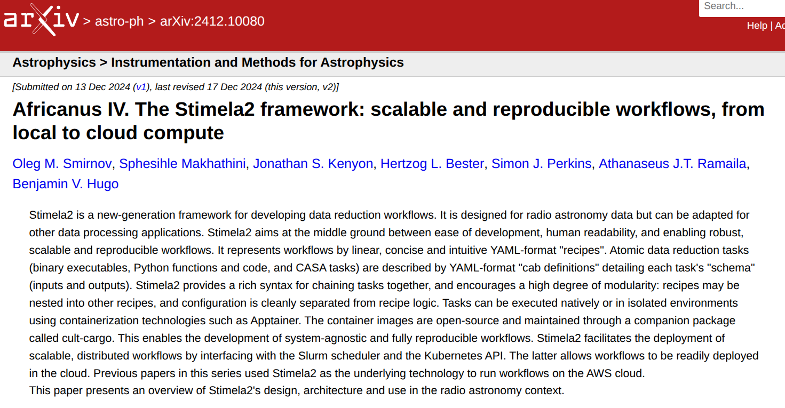
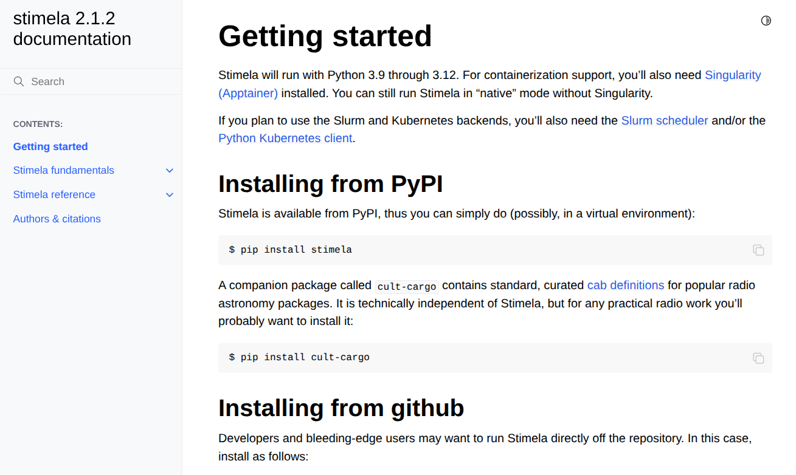
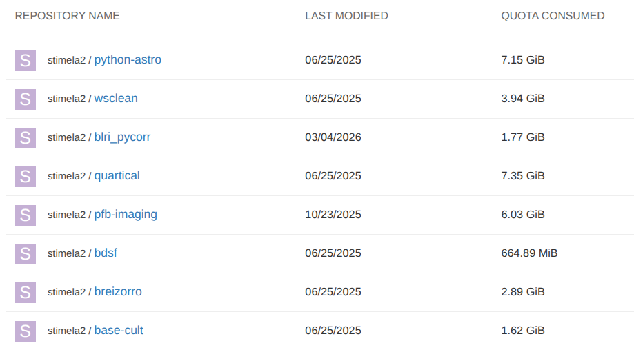
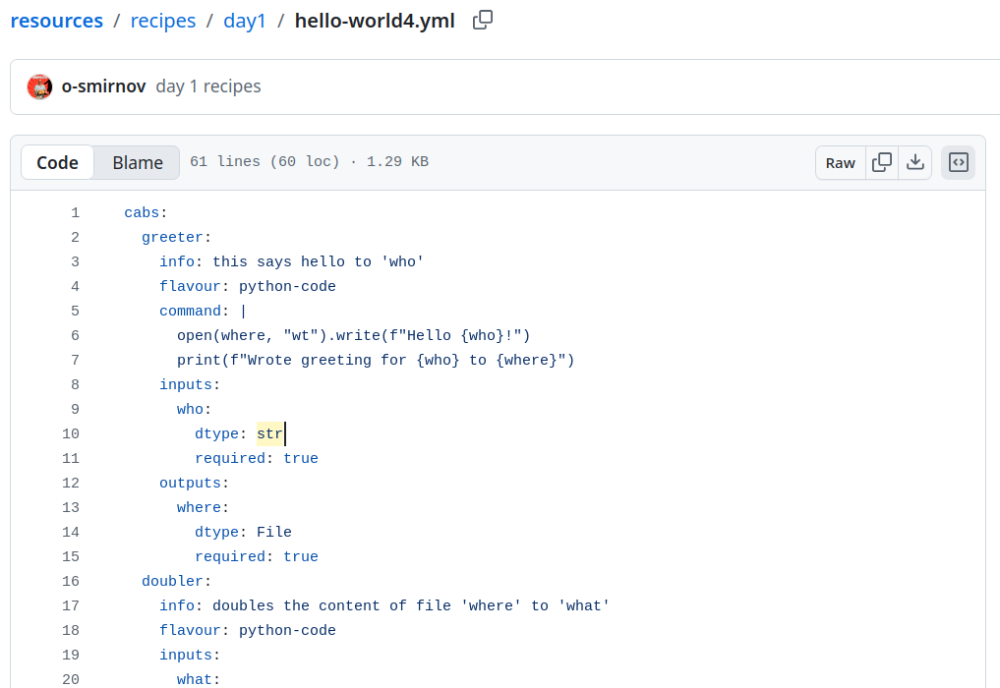

## Stimela - What it is

[{width="80%" fig-align="center"}](https://arxiv.org/abs/2412.10080)


## Stimela — Documentation

[{width="80%" fig-align="center"}](https://stimela.readthedocs.io/en/latest/)

## Stimela — Installation

```bash
$ python3.10 -m venv ccargo

$ source ccargo/bin/activate

$ pip install -U pip wheel 'setuptools[core]'

$ pip install cult-cargo
```

## Stimela Basics

:::: {.columns}
::: {.column width="45%"}

```{mermaid}
%%| fig-width: 4.5
---
config:
  theme: base
  themeVariables:
    lineColor: "#4ade80"
    primaryColor: "#1a5c3a"
    primaryBorderColor: "#4ade80"
    primaryTextColor: "#fff"
    fontFamily: "inherit"
    fontSize: "16px"
---
flowchart LR
    C["📦 &nbsp; CABS &nbsp;"] <-.-> S["⚙️ &nbsp; Stimela &nbsp;"]
    R["📋 &nbsp; RECIPES &nbsp;"] <-.-> S
    D["💾 &nbsp; DATA &nbsp;"] <-.-> S
```
:::

::: {.column width="55%"}
::: {.incremental}
- **Cabs** define *what* can be run
- **Recipes** define *how* to run it
- **Data** flows between steps
:::

::: {.fragment}
::: {.result-box}
Output: calibrated radio astronomy data products
:::
:::
:::
::::

## Stimela and Cult-Cargo {.smaller}

:::: {.columns}
::: {.column width="45%"}

```{mermaid}
%%| fig-width: 4.5
---
config:
  theme: base
  themeVariables:
    lineColor: "#4ade80"
    primaryColor: "#1a5c3a"
    primaryBorderColor: "#4ade80"
    primaryTextColor: "#fff"
    fontFamily: "inherit"
    fontSize: "14px"
---
flowchart LR
    CC["📦 &nbsp; cult-cargo &nbsp;<br />&nbsp; curated cabs &nbsp;"] <-.-> S["⚙️ &nbsp; stimela &nbsp;"]
    UC["🔧 &nbsp; user-cabs &nbsp;"] <-.-> S
    R["📋 &nbsp; recipes &nbsp;"] <-.-> S
    D["💾 &nbsp; data &nbsp;"] <-.-> S
```
:::

::: {.column width="55%"}
**cult-cargo** — companion package of curated, containerised cabs

::: {.fragment}
- Containers hosted at `quay.io/organization/stimela2`
- Open-source, maintained by the community
- Enables **system-agnostic**, fully reproducible workflows
:::

::: {.fragment}
::: {.highlight-box}
cult-cargo containers run via **Apptainer** — no root required on HPC
:::
:::
:::
::::

## cult-cargo containers {.smaller}

[`quay.io/organization/stimela2`](https://quay.io/organization/stimela2)

[{height="400px" fig-align="center"}](https://quay.io/organization/stimela2)

::: {.callout-note appearance="minimal"}
Run `stimela doc -l 'cultcargo::*.yml'` to see the list of available cabs
:::

# Stimela — Hello World

## Stimela — Hello World {.smaller}

`hello_world.yaml`

```yaml
cabs:
  greeter:
    flavour: python-code
    command: print("Hello, world!")

hello:
  steps:
    ola:
      cab: greeter
```

. . .

```bash
$ stimela run hello_world.yaml hello
```

. . .

`cabs:` block — **cab definitions** (what tasks exist)

. . .

`hello:` block — a **recipe** (the workflow to run)

## Reserved Keywords {.smaller}

Don't use any of these as recipe names:

```yaml
cabs:    # for cab definitions

lib:     # reusable components
  recipes:

vars:    # user-defined variables

opts:    # runtime options
  log:

run:     # runtime environment
  env:   # environment variables
    PATH:
```

. . .

::: {.callout-warning appearance="minimal"}
Using reserved keywords as recipe names will cause silent or confusing errors.
:::

## Hello World - Cab Definition {.smaller}

```yaml
cabs:
  greeter:
    info: this says hello to 'who'
    flavour: python-code
    command: |
      open(where, "wt").write(f"Hello {who}!")
      print(f"Wrote greeting for {who} to {where}")
    inputs:
      who:
        dtype: str
        required: true
    outputs:
      where:
        dtype: File
        required: true
```

. . .

[`info:` — useful description of what this cab does]{.muted}

. . .

[`command: |` — multi-line Python code block (YAML literal block scalar)]{.muted}

. . .

[`inputs:`/`outputs:` — the **cab schema** (validated at runtime)]{.muted}

## Hello World - Recipe Definition {.smaller}

```yaml
hello:
  info: This is my hello world recipe
  inputs:
    name:
      dtype: str
      default: world
  steps:
    ola:
      info: this runs the greeter cab to print a greeting
      cab: greeter
      params:
        who: =recipe.name
        where: greeting.txt
```

. . .

[`inputs:` — the **recipe schema** (exposed inputs of this recipe)]{.muted}

. . .

[`steps` — recipes usually have multiple steps]{.muted}

. . .

[`params:` — steps pass recipe I/Os to cab parameters]{.muted}

[`=recipe.name` — **formula substitution** (prefix `=` means evaluate)]{.muted}


## Exercise

::: {.highlight-box}
**Modify this recipe to take the name of the output file as an input**

Starting from `hello_world.yaml`:

1. Add an `outfile` input to the recipe schema (`dtype: File`, `default: greeting.txt`)
2. Pass it through to the `where` parameter of the `ola` step
:::

## And Now for a More Convoluted Example!

[{width="80%" fig-align="center"}](https://github.com/africalim/resources/blob/main/recipes/day1/hello-world4.yml)

::: {.closing-slide}
## Thanks!

::: {.contact}
landman.bester@sarao.ac.za
:::
:::
