# Why interferometry?

## The Atmospheric Window

{width="85%" fig-align="center"}

## Bigger Is Better…

:::: {.columns}
::: {.column width="50%"}
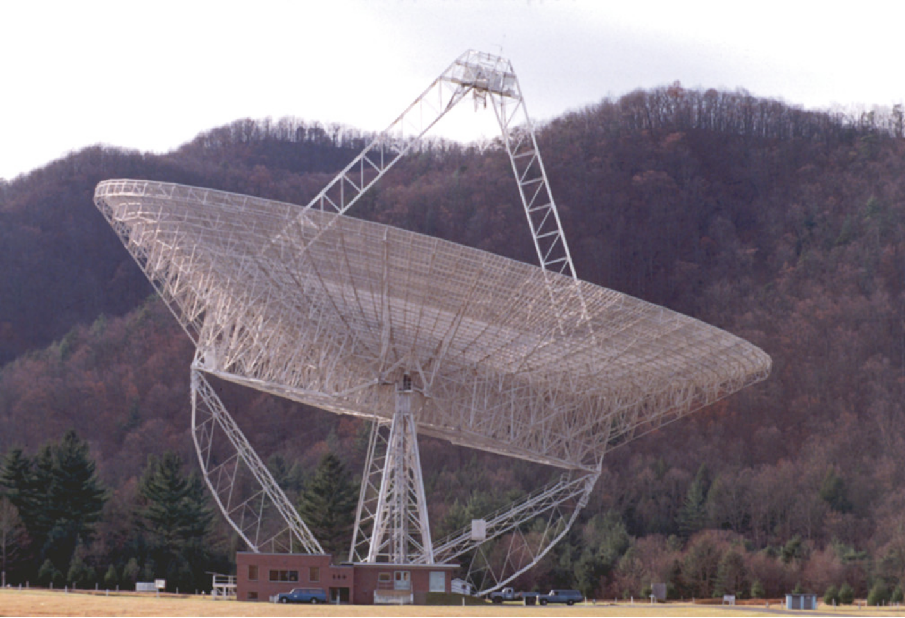{width="100%"}
:::

::: {.column width="50%"}
::: {.fragment}
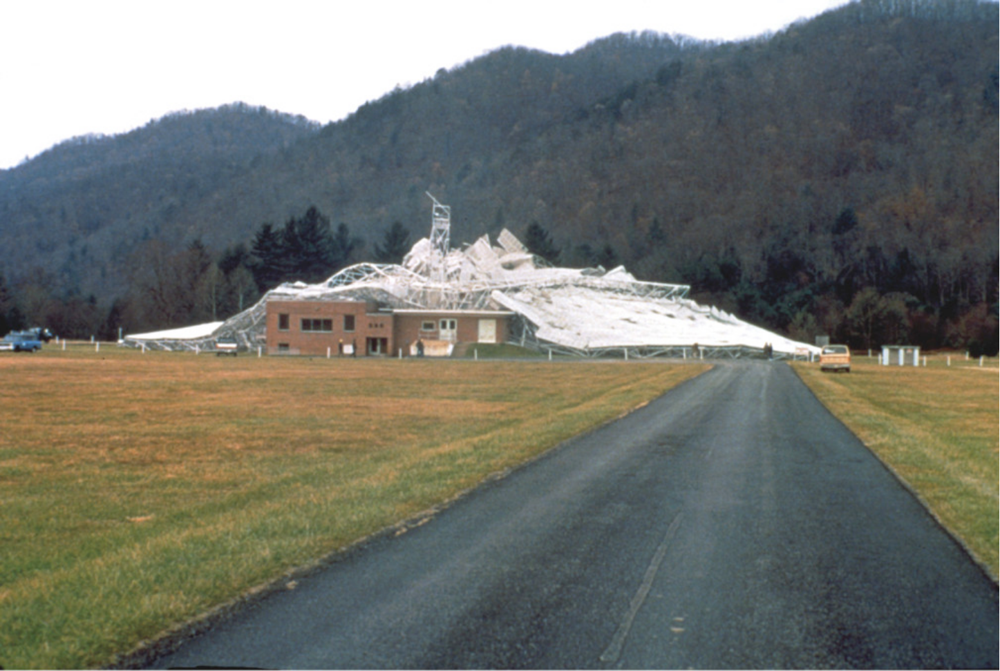{width="100%"}
:::
:::
::::

## Resolution {.smaller}

:::: {.columns}
::: {.column width="45%"}
::: {.r-stack}
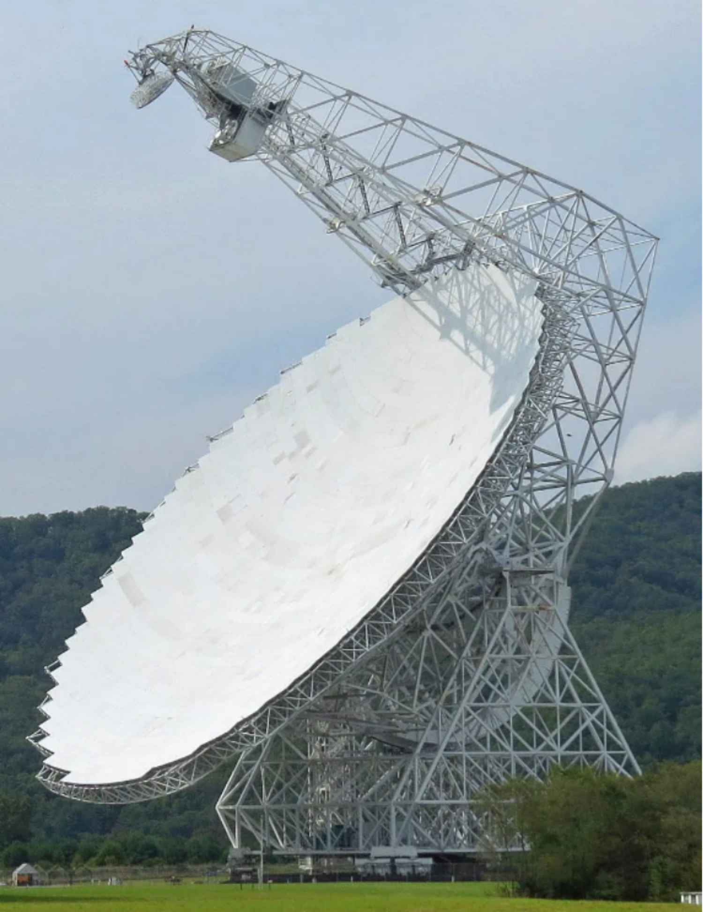{height="520"}

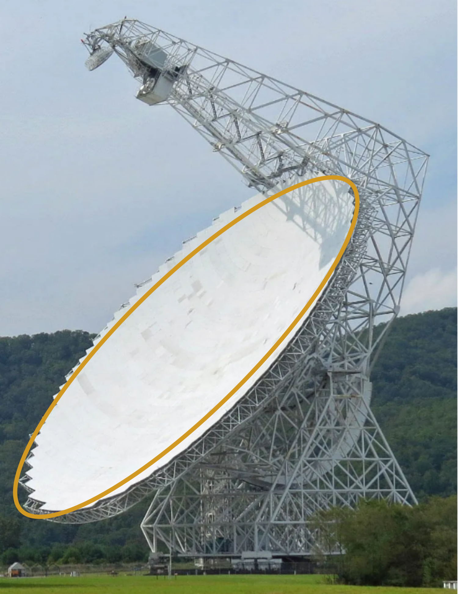{.fragment fragment-index=1 height="520"}

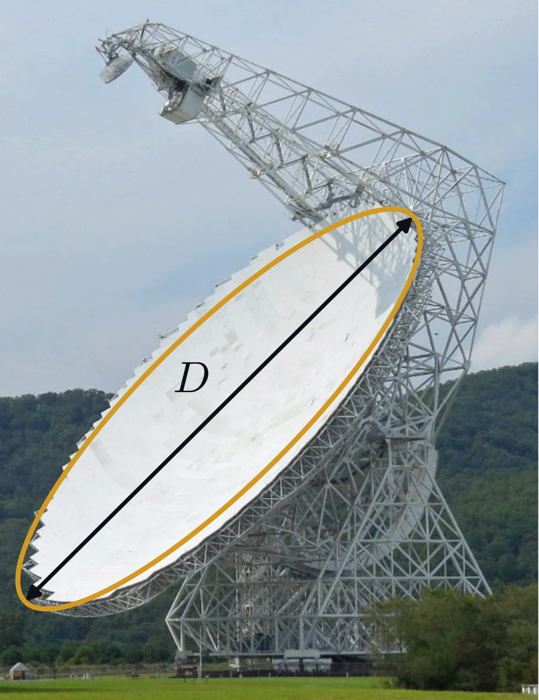{.fragment fragment-index=2 height="520"}
:::
:::

::: {.column width="55%"}
::: {.fragment fragment-index=1}
The **aperture**: the part of the dish that collects radio waves
:::

::: {.fragment fragment-index=2}
The finest detail it can separate:

$$\Delta\theta \approx \frac{\lambda}{D}$$
:::

::: {.fragment fragment-index=3}
$\lambda$ is the **observing wavelength**, $D$ the dish **diameter**
:::

::: {.fragment fragment-index=4 .highlight-box}
Bigger dish, or shorter wavelength: **finer detail**
:::
:::
::::

## What Does "Resolved" Mean?

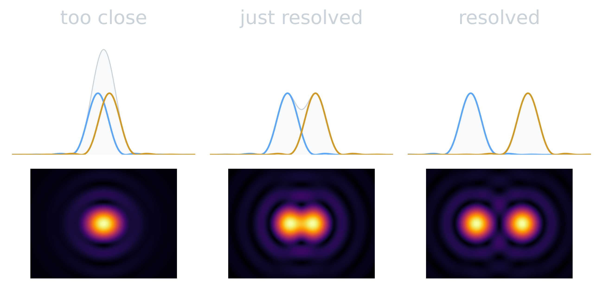{width="84%" fig-align="center"}

::: {.muted}
Two sources closer together than about $\lambda/D$ blur into one.
:::

## Sensitivity {.smaller}

:::: {.columns}
::: {.column width="45%"}
::: {.r-stack}
{height="520"}

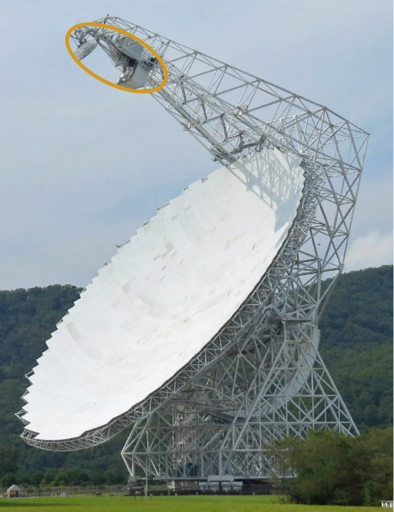{.fragment fragment-index=1 height="520"}

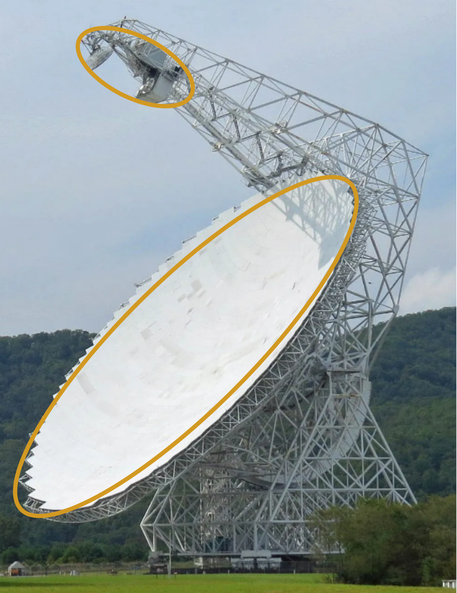{.fragment fragment-index=2 height="520"}
:::
:::

::: {.column width="55%"}
::: {.fragment fragment-index=1}
The **receiver** turns the focused radio waves into a voltage
:::

::: {.fragment fragment-index=2}
**Sensitivity**, how faint a source we can detect, improves with:

- more **collecting area**
- a **colder** receiver, which adds less noise of its own
:::
:::
::::

## …But Dishes Can Only Get So Big {.smaller}

::: {.incremental}
- A bigger dish collects **more signal** and sees **finer detail**
- At radio wavelengths, arcsecond detail needs a dish **tens of kilometres** across
- Nobody can build that — or keep it from falling down
:::

. . .

::: {.highlight-box}
**Aperture synthesis**: combine many small antennas into one giant *virtual* telescope.
:::

# The two-element interferometer

## How to Make an Interferometer?

::: {.r-stack}
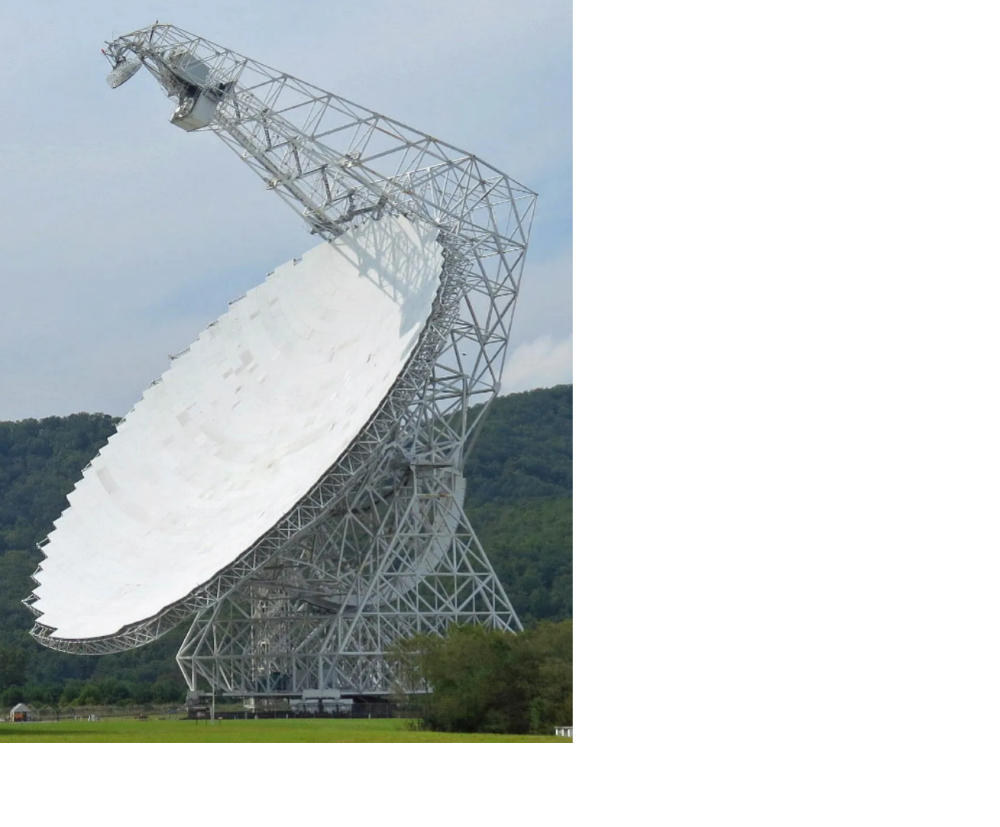{height="540"}

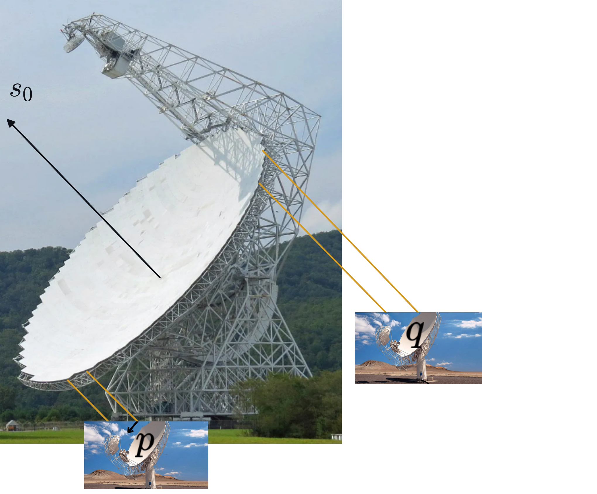{.fragment height="540"}

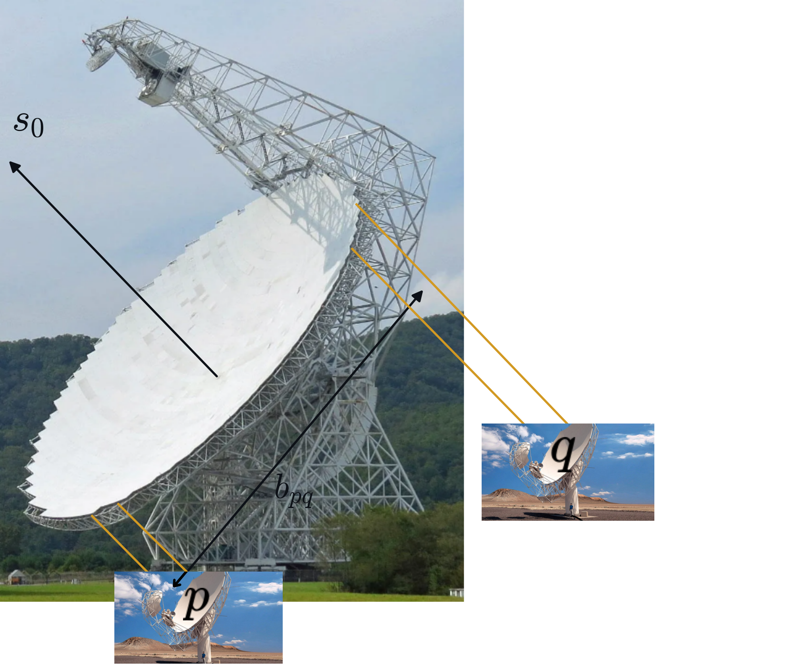{.fragment height="540"}

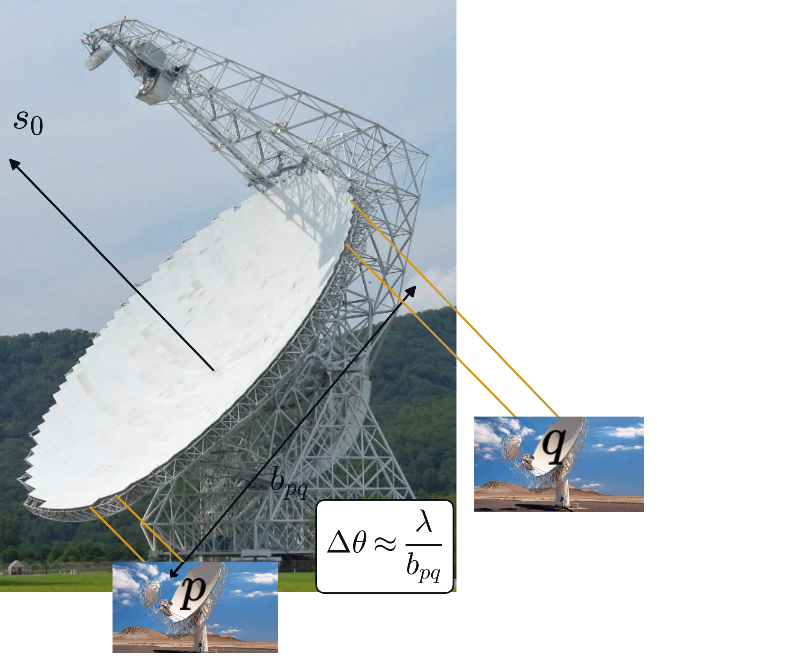{.fragment height="540"}

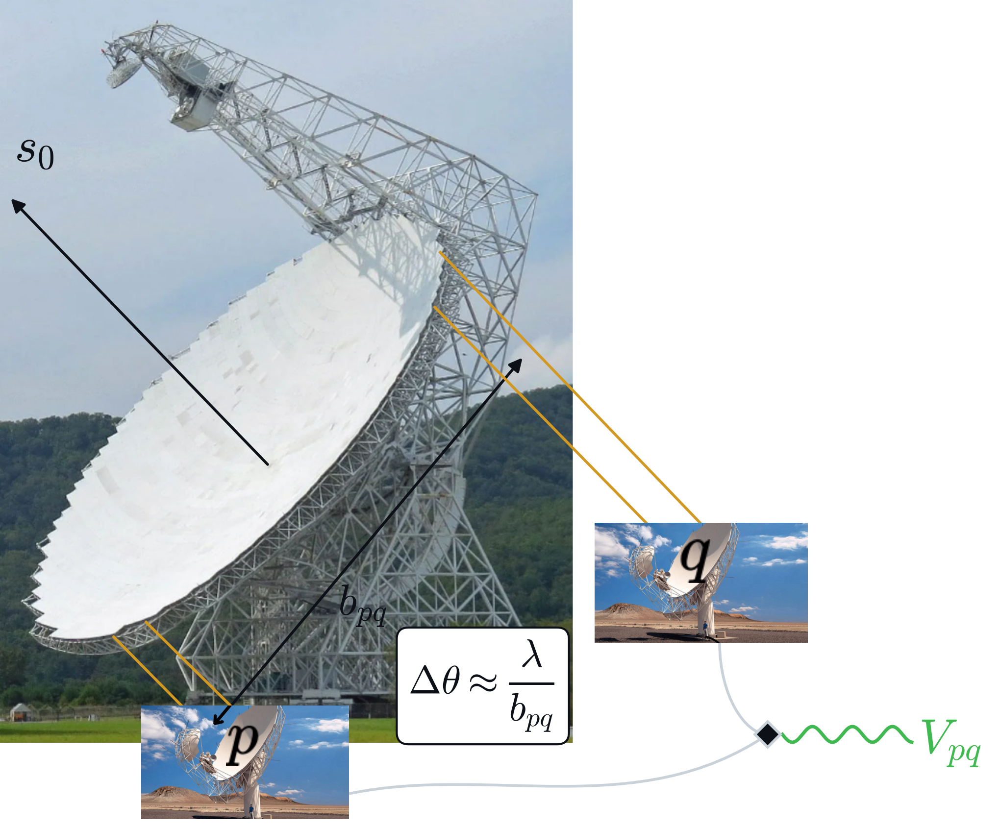{.fragment height="540"}
:::

::: {.notes}
Keep just two pieces of the big aperture, p and q, as dishes of their own.
Their separation, the baseline, now sets the resolution: lambda over b, not lambda over D.
The correlator combines the two signals into one number, the visibility V_pq.
:::

## Two Antennas, One Wave

::: {.incremental}
- Two antennas, some distance apart, listen to the **same** distant source
- A source off to one side reaches one antenna **before** the other
- To combine the signals we first have to **undo that delay**
:::




## What We Just Saw {.smaller}

:::: {.columns}
::: {.column width="45%"}
{width="100%"}
:::

::: {.column width="55%"}
::: {.incremental}
- The wave reaches the two antennas at **different times**
- The difference depends on the **direction** of the source and the **distance** between the antennas — the **baseline**
- The correlator delays the early signal so the two line up: **phasing up**
- The finest detail a pair can see is set by the wavelength divided by the **baseline** — not the dish size
:::
:::
::::

# What is a visibility?

## Multiply and Average

The correlator does one simple thing: **multiply** the two signals together and **average**.

. . .

::: {.highlight-box}
That single averaged number — measured for one pair of antennas — is a **visibility**.
:::

::: {.notes}
Lead into the second animation: what does that one number tell us about the sky?
:::



# Spatial filtering

## Each Baseline Is a Filter {.smaller}

Each pair of antennas looks at the sky through a pattern of **stripes** — a *fringe*.

. . .

:::: {.columns}
::: {.column width="50%"}
**Short baseline**

::: {.incremental}
- wide stripes
- sees **large, smooth** structure
- blurrs fine detail
:::
:::

::: {.column width="50%"}
**Long baseline**

::: {.incremental}
- narrow stripes
- sees **fine detail**
- *resolves out* large structure
:::
:::
::::

. . .

::: {.result-box}
Like the bands of a graphic equaliser: each baseline picks out **one size scale** on the sky.
:::

## Try It: The Fringe Explorer {.smaller}

::::: {.columns .ojs-controls}
::: {.column width="33%"}
```{ojs}
//| echo: false
viewof b = Inputs.range([0.5, 20], {value: 4, step: 0.5, label: "Baseline"})
```
:::
::: {.column width="33%"}
```{ojs}
//| echo: false
viewof width = Inputs.range([0.002, 0.06], {value: 0.03, step: 0.002, label: "Source size"})
```
:::
::: {.column width="33%"}
```{ojs}
//| echo: false
viewof l0 = Inputs.range([-0.1, 0.1], {value: 0, step: 0.005, label: "Position"})
```
:::
:::::

```{ojs}
//| echo: false
sky = {
  const ls = d3.range(-0.25, 0.2501, 0.001);
  const norm = 0.024 / width;                     // keep the total flux fixed
  return ls.map(l => {
    const I = norm * Math.exp(-0.5 * ((l - l0) / width) ** 2);
    const f = Math.cos(2 * Math.PI * b * l);
    return {l, I, f, p: I * f};
  });
}
amp = Math.exp(-2 * (Math.PI * b * width) ** 2)
phase = ((-360 * b * l0) % 360 + 540) % 360 - 180
```

:::: {.columns}
::: {.column width="62%"}
```{ojs}
//| echo: false
Plot.plot({
  width: 620, height: 270,
  style: {background: "transparent", color: "#c9d1d9", fontSize: "15px"},
  x: {label: "direction on the sky →", ticks: []},
  y: {label: null, ticks: [], domain: [-1.3, 1.3]},
  marks: [
    Plot.ruleY([0], {stroke: "#30363d"}),
    Plot.line(sky, {x: "l", y: "f", stroke: "#8b949e", strokeWidth: 1.5}),
    Plot.areaY(sky, {x: "l", y: "p", fill: "#3fb950", fillOpacity: 0.45}),
    Plot.line(sky, {x: "l", y: "I", stroke: "#d29922", strokeWidth: 3})
  ]
})
```

::: {.muted}
[grey]{.key-fringe} fringe · [gold]{.key-source} source · [green]{.key-product} measured
:::
:::

::: {.column width="38%"}
```{ojs}
//| echo: false
Plot.plot({
  width: 360, height: 220,
  style: {background: "transparent", color: "#c9d1d9", fontSize: "15px"},
  marginBottom: 45,
  x: {label: "baseline →", labelAnchor: "center", labelOffset: 40, domain: [0, 20]},
  y: {label: "fringe contrast", domain: [0, 1.05]},
  marks: [
    Plot.line(d3.range(0, 20.01, 0.1),
              {x: d => d, y: d => Math.exp(-2 * (Math.PI * d * width) ** 2),
               stroke: "#58a6ff", strokeWidth: 2.5}),
    Plot.dot([[b, amp]], {r: 7, fill: "#3fb950"})
  ]
})
```

```{ojs}
//| echo: false
md`**Contrast** ${amp.toFixed(2)} · **offset** ${phase.toFixed(0)}°`
```
:::
::::

::: {.notes}
Grow the source: the green area cancels, contrast falls. Lengthen the baseline: same effect.
Move the source: the contrast stays put, only the offset (the phase) changes.
:::

## What Gets Resolved Out {.smaller}

::: {.incremental}
- A source **bigger than the stripes** covers bright and dark at once — the fringe **washes out**
- Long baselines alone would miss the smooth glow of the **Milky Way** or the **Sun**
- Short baselines alone would blur every source into a blob
:::

. . .

::: {.highlight-box}
We need **many** baselines, of many **lengths** and **orientations**.
:::

# Visibility space

## One Pair, One Point

::: {.incremental}
- The sky is **two-dimensional**: each pair's stripes have a spacing **and** a direction
- Plot each pair as a point: **how long** the baseline is and **which way** it points
- That map of everything we measured is **visibility space** — the *uv-plane*
- Every new dish pairs up with **all** the others: the points multiply quickly
:::

## The MeerKAT Array

{width="75%" fig-align="center"}

::: {.muted}
64 dishes make **2016** pairs: 2016 points in visibility space at every instant.
:::

::: {.notes}
Next, the same idea with a toy array of just seven dishes. Watch three things fill
visibility space: more dishes, the Earth turning, and more frequencies. Then watch
what picture we can make from what we measured.
:::



## What the Holes Cost Us

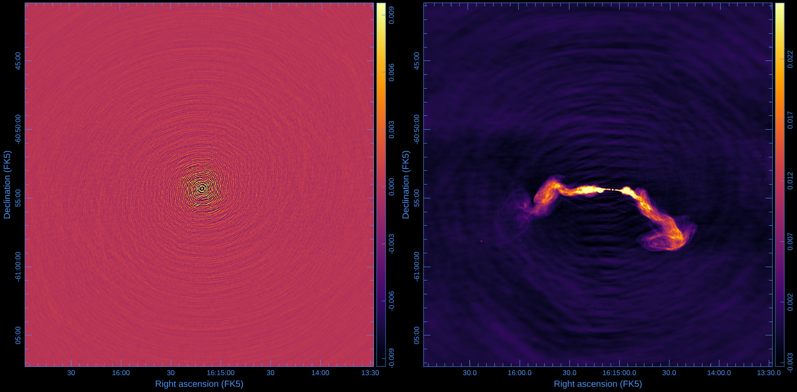{width="90%" fig-align="center"}

::: {.muted}
Even 64 dishes leave gaps in visibility space, and the gaps become ripples in the image.
Removing them is the job of **imaging and deconvolution**.
:::

::: {.notes}
The animation ended on the dirty image of a toy sky. Here is the real thing.
Left: the dirty image of a single point source, the PSF. Those rings are the holes in
visibility space. Right: every point of a real source is smeared by that same pattern.
:::

## Summary {.smaller}

::: {.incremental}
- An interferometer combines small antennas into one large **virtual telescope**
- Each pair must be **phased up**: delay the early signal to match the late one
- A **visibility** is the averaged product of the two signals — the **contrast and position** of a fringe
- Each baseline is a **spatial filter**: short sees big, long sees small
- **Visibility space** records which scales we measured — and which we missed
:::

## Thanks! {background-color="#0d1117" .closing-slide}

Questions?

::: {.contact}
lbester@sarao.ac.za
:::
